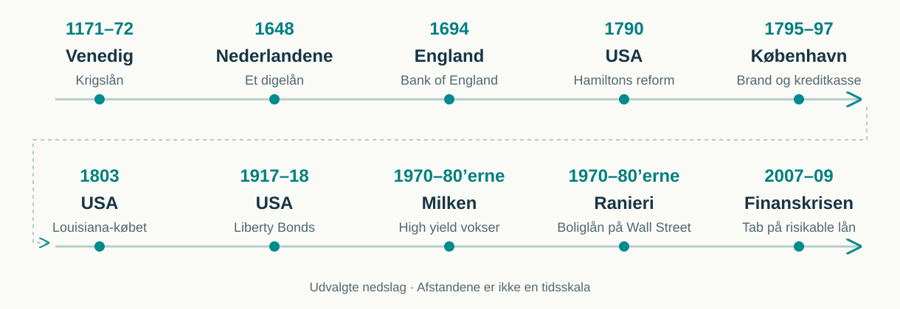
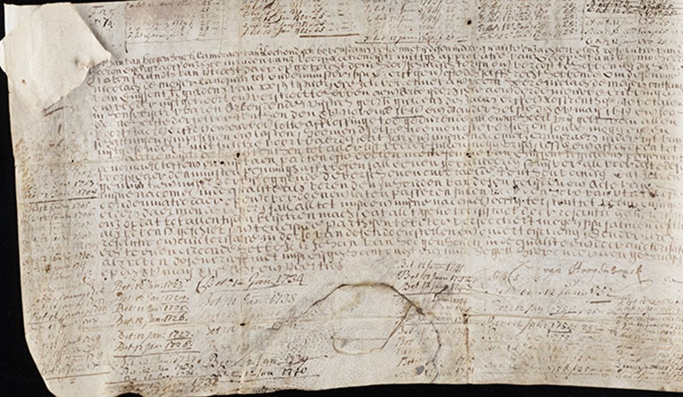
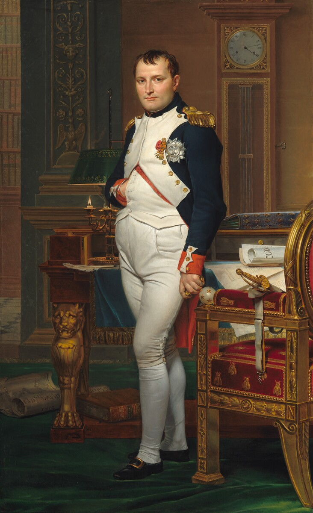
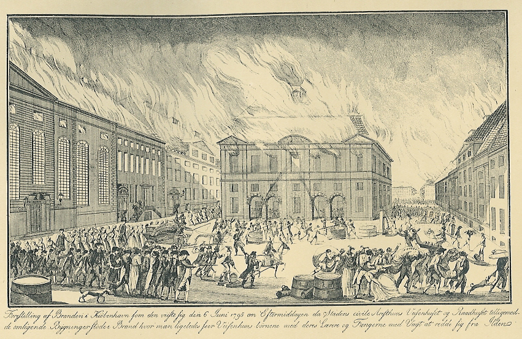
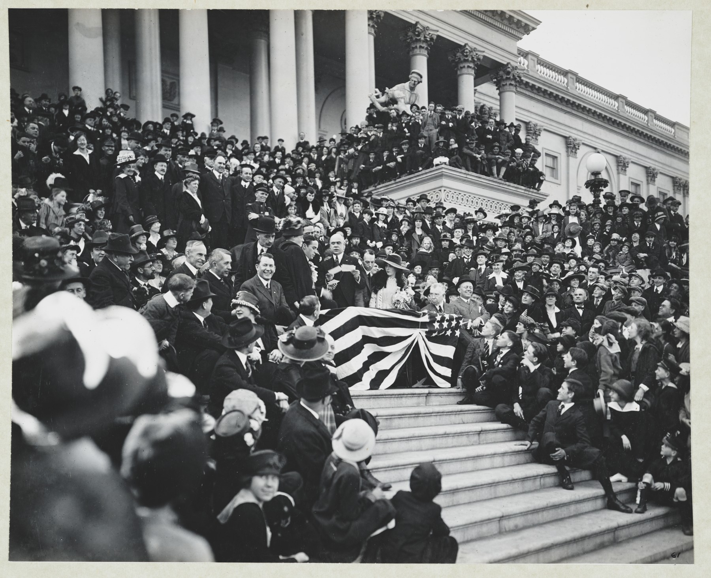
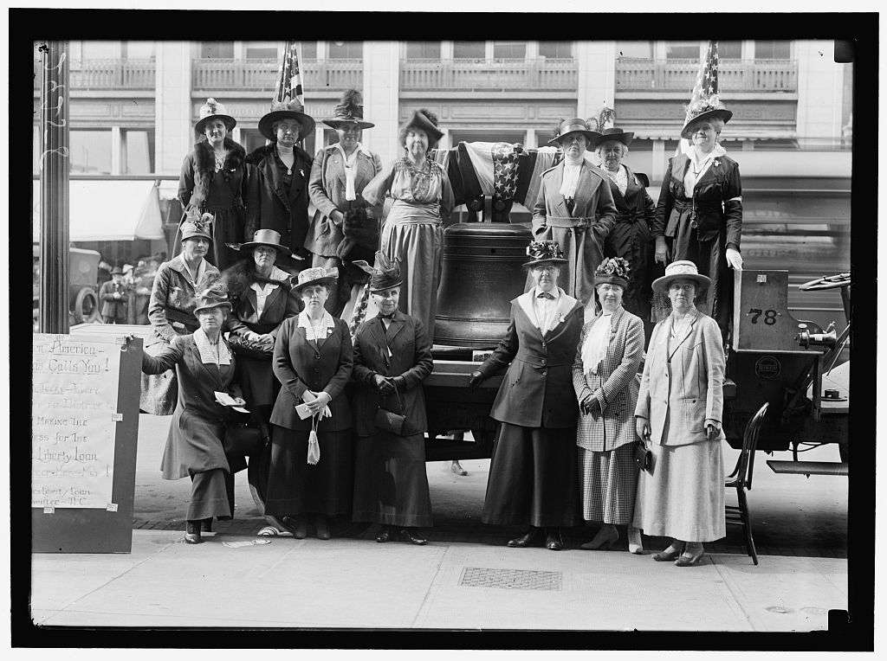

## Niklas Lehmann Jensen {#intro-underviser .history-slide}

::: {.history-era}
Jeres underviser
:::

- **2021:** Cand.oecon.
- **2021–2023 · Sydbank:** Analytiker inden for porteføljemanagement og risikomodeller.
- **Siden 2023 · Scanrate:** Senioranalytiker.
- **Fra 2022 · SDU:** Undervisning i matematik og makroøkonomi på HA Almen.
- **Siden 2024 · AU:** Undervisning i finansiering.

## Hvem betaler, når historien tager en drejning? {#intro-historie .history-slide .history-timeline}

::: {.history-lead}
Et obligationslån skaffer penge nu mod et løfte om betaling senere.
:::

{fig-alt="Historiske nedslag: Venedigs krigslån i 1171–72, hollandsk digelån i 1648, Bank of England i 1694, Hamiltons gældsreform i 1790, Københavns brand og kreditkasse i 1795–97, Louisiana-købet i 1803, Liberty Bonds i 1917–18, Milken og Ranieri i 1970–80’erne og finanskrisen i 2007–09."}

::: {.history-credit}
Inspireret af Robin Wigglesworths *A Fabulous Debt*. Kilder følger på de enkelte slides.
:::

::: {.notes}
Brug cirka 12–15 minutter på den historiske åbning. Bogen er inspiration til fortællingen; de konkrete oplysninger er kontrolleret mod kilderne på de følgende slides.

Tidslinjen viser udvalgte begivenheder, ikke opfindelsen af al gæld eller en ubrudt kæde af fremskridt. Årstal er placeret i rækkefølge, men afstandene er ikke en tidsskala. Vi følger nedslagene kronologisk fra Venedig til finanskrisen. København kommer før Louisiana-købet. Hamiltons reform fra 1790 nævnes som baggrund for USA’s køb i 1803; Englands slide viser også de senere følger under Napoleonskrigene.
:::

## Venedig låner til en krigsflåde {#intro-venedig .history-slide}

::: {.history-era}
1171–72 → 1262 · Venedig
:::

:::: {.history-grid}
::: {}
- Kejseren i Det Byzantinske Rige fængsler venetianske købmænd og beslaglægger deres ejendom. Venedig sender en flåde for at få dem frigivet.
- Staten tvinger velhavende borgere til at låne den penge.
- Borgerne får et tilgodehavende hos staten.
- Fra 1262 findes et organiseret marked for gælden.
- Borgerne kan sælge deres tilgodehavender og få pengene før statens tilbagebetaling.
:::
::: {.history-art}
{fig-alt="Canalettos maleri af skibe, gondoler og handelsliv ved indsejlingen til Canal Grande."}

::: {.history-caption}
Venedigs havn, malet af Canaletto i 1742–44. National Gallery of Art, public domain.
:::
:::
::::

::: {.history-sources}
Kilder: [Schmelzing (2020), s. 18–19](https://www.bankofengland.co.uk/-/media/boe/files/working-paper/2020/eight-centuries-of-global-real-interest-rates-r-g-and-the-suprasecular-decline-1311-2018) · [Pezzolo (2005)](https://iris.unive.it/handle/10278/4445)
:::

::: {.notes}
Venedig er et tidligt eksempel på omsættelig offentlig gæld. Skeln mellem tvangslånet i 1171–72 og det senere organiserede marked. Schmelzing beskriver, at det første lån ikke betalte renter i over tre årtier; fra 1262 fastsattes en årlig kupon på 5 procent. Undgå derfor at fremstille 1171-lånet som en moderne, frit købt obligation med punktlige betalinger fra starten.

Spørg mundtligt: Hvad betyder muligheden for at sælge videre for den, der har lånt staten penge? Maleriet viser byen flere århundreder senere, ikke flåden i 1171.

Den umiddelbare anledning var kejser Manuel I’s arrestationer og beslaglæggelser i 1171. Konflikten havde også en længere baggrund i handel og magtpolitik. Kilde: Donald M. Nicol, Byzantium and Venice, kapitel 7, https://www.cambridge.org/core/books/abs/byzantium-and-venice/calm-before-the-storm/5269F2A43B0DCF95E74D38E54286E5D1.

Baggrund for flåden mod Det Byzantinske Rige: Pezzolo, kapitel 8 i The Origins of Value; redaktørernes introduktion: https://vintagequants.com/wp-content/uploads/2024/09/Goetzmann-Origins_Value_Introduction.pdf.
:::

## Et hollandsk digelån betaler stadig renter {#intro-holland .history-slide}

::: {.history-era}
1600-tallet · Nederlandene
:::

:::: {.history-grid}
::: {}
- Hollænderne gør offentlige lån til en bredere opsparingsform med skatter og afgifter til at betale renterne.
- Långivere kan overdrage gælden eller bruge den som sikkerhed for egne lån. Pengene er dermed lettere at få adgang til igen.
- Et lån fra 1648 finansierer arbejde på diger og flodbredder.
- Lånet har ingen fast udløbsdato: renterne kan fortsætte i generationer.
- Yale ejer obligationen i dag og kan stadig opkræve renter.
:::
::: {.history-art}
{fig-alt="Den originale hollandske obligation fra 1648, skrevet på pergament."}

::: {.history-caption}
Obligationen fra 1648. Beinecke Library, Yale University. Digital gengivelse af et historisk dokument.
:::
:::
::::

::: {.history-sources}
Kilder: [Gelderblom & Jonker (2011)](https://people.bu.edu/chamley/HSFref/GelderblomJonkerJEH11.pdf) · [Yale (2015)](https://news.yale.edu/2015/09/22/living-artifact-dutch-golden-age-yale-s-367-year-old-water-bond-still-pays-interest) · [Yale (2026)](https://som.yale.edu/story/2026/prof-rouwenhorst-discusses-yales-378-year-old-perpetual-bond-bbc)
:::

::: {.notes}
Lånet på 1.000 Carolus-gylden blev udstedt den 15. maj 1648 af Lekdijk Bovendams. Det finansierede blandt andet anlæg, der styrede vandstrømmen og begrænsede erosion. Det er en lokal vandmyndigheds gæld, ikke et statslån fra Holland. Renten blev sænket flere gange, så man må ikke sige, at alle vilkår har været uændrede i 378 år.

Gelderblom og Jonker viser, at offentlige gældsbeviser kunne overdrages og belånes. Mange investorer kunne også få penge tilbage hos skatteopkræverne. Et fuldt udviklet marked for videresalg af provinsen Hollands gæld kom først sent i 1600-tallet; undgå at sidestille det med det tidligere aktive marked for VOC-aktier. Kilde: “Public Finance and Economic Growth: The Case of Holland in the Seventeenth Century” (2011), https://people.bu.edu/chamley/HSFref/GelderblomJonkerJEH11.pdf.

Forbedringen er praktisk: faste lokale indtægter og en varig organisation kan understøtte lån til anlæg, der bruges længe. Nederlandene udbyggede samtidig markeder for offentlig gæld. Det er et bredere forløb end den ene obligation. Baggrund: Goetzmann og Rouwenhorst, “Perpetuities in the Stream of History”, The Origins of Value (2005), kapitel 9; https://www.hdsr.nl/werk/watererfgoed/digitale/watererfgoedverhalen/dijkdoorbraak-1624/tijdlijn-dijkdoorbraak-1624/.
:::

## Storbritannien kan låne sig til at holde ud {#intro-england .history-slide}

::: {.history-era}
1694 → 1815 · England og senere Storbritannien
:::

:::: {.history-grid}
::: {}
- England henter inspiration i hollandske lån med skatteindtægter til renterne og værdipapirer, som investorer kan sælge videre.
- Bank of England oprettes i 1694 og låner staten £1,2 mio. til krig.
- Skatter og en troværdig betalingshistorik gør store lån mulige.
- Under Napoleonskrigene har briterne lettere adgang til lån end Frankrig.
- Lån finansierer flåde, hær og allierede gennem en lang krig.
:::
::: {.history-art}
{fig-alt="Jacques-Louis Davids portræt af Napoleon ved sit skrivebord i 1812."}

::: {.history-caption}
Napoleon i 1812, malet af Jacques-Louis David. National Gallery of Art, public domain.
:::
:::
::::

::: {.history-sources}
Kilder: [Newton Project, Oxford](https://dev.newtonproject.ox.ac.uk/introduction/the-financial-revolution) · [Bank of England](https://www.bankofengland.co.uk/freedom-of-information/2020/details-of-the-bank-of-england-loan-to-the-government-in-1694) · [Bordo & White (1991)](https://www.researchwithrutgers.org/en/publications/a-tale-of-two-currencies-british-and-french-finance-during-the-na/)
:::

::: {.notes}
Kredit gav Storbritannien mulighed for at føre krig i længere tid og støtte sine allierede. Det bidrog til koalitionernes styrke; det er ikke en enkeltstående forklaring på Napoleons nederlag. Frankrig var mere afhængigt af skatter og ydelser fra erobrede områder.

Vis ikke et løsrevet britisk/fransk rentepar: kupon, markedsrente, tidspunkt og lånetype skal kunne sammenlignes. Bank of Englands første statslån i 1694 havde 8 procent i rente; det tal beskriver ikke lånevilkårene under Napoleonskrigene et århundrede senere.

England kunne bygge videre på erfaringer med at knytte renter til bestemte skatteindtægter og gøre finansielle krav omsættelige. I London blev statslånene efterhånden samlet og handlet i større skala med Parlamentet og Bank of England som centrale institutioner. Det var en gradvis udvikling og ingen direkte kopi af én hollandsk bank.

Hollandsk inspiration: https://dev.newtonproject.ox.ac.uk/introduction/the-financial-revolution. Bankens bidrag til krigsfinansieringen: O’Brien og Palma, https://onlinelibrary.wiley.com/doi/10.1111/ehr.13191. Parlamentarisk kontrol og skatteopkrævning udviklede sig over tid; troværdighed kom ikke fra én lov alene.
:::

## København skal genopbygges efter branden {#intro-koebenhavn .history-slide}

::: {.history-era}
1795–97 · Danmark
:::

:::: {.history-grid}
::: {}
- Branden i 1795 ødelægger over 900 ejendomme i København.
- Genopbygningen kræver mere kapital, end husejerne selv har.
- I 1797 oprettes Husejernes Kreditkasse på långivernes initiativ.
- Obligationer skaffer penge til lån med sikkerhed i ejendommene.
- Det bliver begyndelsen på dansk realkredit, som vi møder i kapitel 5.
:::
::: {.history-art}
{fig-alt="Historisk illustration af branden på Gammeltorv i København i 1795, med det brændende rådhus i midten."}

::: {.history-caption}
Gammeltorv og rådhuset under branden i 1795. Gengivet i *En kjøbenhavnsk Embedsmand* (1918), public domain.
:::
:::
::::

::: {.history-sources}
Kilder: [Finans Danmark](https://finansdanmark.dk/realkredit/dansk-realkredit/realkredittens-historie/) · [Andersen (1947), Kreditkassen for Husejerne i Kjøbenhavn](https://jura.ku.dk/jurabog/pdf/juridiske-monografier/andersen_kreditkassen_for_husejerne_i_kjoebenhavn_1947.pdf)
:::

::: {.notes}
Et obligationsmarked kan finansiere både stater og private ejendomme. Kreditkassen fra 1797 var en forløber for det danske realkreditsystem; de senere låntagerstyrede kreditforeninger kom efter loven i 1850.

Finans Danmark beskriver, at renteloftet på 4 procent gjorde sikkerhed særlig vigtig for långiverne. Gem de institutionelle detaljer og det moderne balanceprincip til kapitel 5. Her skal de studerende blot følge pengene: investorer køber obligationer, kreditkassen yder lån, og husejere bygger op igen.
:::

## USA køber Louisiana med lånte penge {#intro-usa .history-slide}

::: {.history-era}
1803 · USA, efter Hamiltons gældsreform
:::

:::: {.history-grid}
::: {}
- Hamiltons reform fra 1790 har samlet krigsgæld hos forbundsstaten.
- Told og afgifter skal sikre, at staten betaler sine kreditorer.
- I 1803 køber USA Louisiana af Frankrig for 15 mio. dollar.
- Frankrig får 11,25 mio. dollar i obligationer med 6 % rente.
- USA bliver omtrent dobbelt så stort; Napoleon får midler til sine europæiske planer.
:::
::: {.history-art}
{fig-alt="Louisiana-traktatens udsmykkede omslag og seglkapsel fra 1803."}

::: {.history-caption}
Louisiana-traktatens omslag og seglkapsel, 1803. National Archives, USA. Territoriet rækker langt ud over nutidens Louisiana.
:::
:::
::::

::: {.history-sources}
Kilder: [U.S. Treasury](https://home.treasury.gov/about/history/prior-secretaries/alexander-hamilton-1789-1795) · [Traktaten, 1803](https://www.archives.gov/milestone-documents/louisiana-purchase-treaty) · [Office of the Historian](https://history.state.gov/milestones/1801-1829/louisiana-purchase)
:::

::: {.notes}
Hamiltons reformer byggede amerikansk kredit op, blandt andet med overtagelse af delstaternes krigsgæld og sikrere indtægter. USA overtog ikke allerede da Storbritanniens rolle som verdens finansielle centrum. Hamilton var heller ikke manden bag selve Louisiana-købet; det skete under Jefferson.

Købesummen bestod af 11,25 mio. dollar i amerikanske 6-procents obligationer og op til 3,75 mio. dollar til amerikanske borgeres krav mod Frankrig. Betalingskonventionens artikel 2 fastlægger obligationsdelen. Britiske og hollandske finanshuse formidlede papirerne, så Frankrig kunne omsætte dem til penge.

Napoleons salg hang sammen med den mislykkede ekspedition til Saint-Domingue, det senere Haiti, og udsigten til fornyet krig med Storbritannien. Territoriet var beboet af oprindelige folk; traktaten overførte Frankrigs territoriale krav og førte til yderligere amerikansk ekspansion.

Gældsovertagelsen: https://home.treasury.gov/news/press-releases/hp867. Finansieringen: https://www.archives.gov/publications/prologue/2003/spring/louisiana-purchase.html.
:::

## Chaplin sælger obligationer til amerikanerne {#intro-liberty .history-slide}

::: {.history-era}
1917–18 · USA går ind i Første Verdenskrig
:::

:::: {.history-grid}
::: {}
- USA skal hurtigt skaffe penge til krigen mod Tyskland.
- Fire Liberty Loan-kampagner sælger krigsobligationer til befolkningen.
- En obligation kan købes for 50 dollar og giver renter til køberen.
- Charlie Chaplin og andre filmstjerner trækker folk til salgsmøderne.
- Propagandaen gør obligationskøb til en patriotisk handling og udmaler fjenden som brutal.
:::
::: {.history-art}
{fig-alt="Charlie Chaplin sammen med politikeren James Beauchamp Clark ved et Liberty Bond-arrangement ved Kongressen i 1918."}

::: {.history-caption}
Chaplin og Repræsentanternes Hus’ formand, Champ Clark, 1918. Library of Congress / U.S. Capitol Visitor Center.
:::
:::
::::

::: {.history-sources}
Kilder: [Federal Reserve History](https://www.federalreservehistory.org/essays/liberty-bonds) · [U.S. Capitol Visitor Center](https://www.visitthecapitol.gov/artifact/liberty-bond-rally-us-capitol-photograph-1918) · [National Park Service](https://www.nps.gov/articles/000/over-here-over-there-america-and-world-war-i.htm)
:::

::: {.notes}
Forklar forskellen på at donere og at låne: køberen får et værdipapir med renter og krav på tilbagebetaling. Samtidig blev salget forbundet med loyalitet og socialt pres. Beskriv fjendebilledet som samtidens propaganda, ikke som forelæserens vurdering af tyskere.

Fire Liberty Loans fandt sted i 1917–18; Victory Loan fulgte i 1919. De 50 dollar er mindste pålydende i den første udstedelse. Det var stadig et betydeligt beløb for en almindelig familie.

USA's økonomiske og finansielle vægt voksede under verdenskrigen. Det er en senere udvikling end Hamiltons reformer og Louisiana-købet.
:::

## Krigsindsatsen bliver et argument for rettigheder {#intro-liberty-rettigheder .history-slide}

::: {.history-era}
1917–20 · Hvem får fuldt medborgerskab?
:::

:::: {.history-grid}
::: {}
- Kvinder både køber obligationer og organiserer salget.
- Efter en samtidig opgørelse var knap hver tredje køber i første kampagne en kvinde.
- Wilson bruger kvinders krigsindsats som argument for stemmeret i 1918.
- Afroamerikanere støtter også krigslånene og håber på større lighed.
- I 1920 sikres kvinders stemmeret i forfatningen. Racistiske valgregler holder stadig mange afroamerikanere ude.
:::
::: {.history-art}
{fig-alt="Kvinder fra en Liberty Loan-komité foran en kopi af Liberty Bell i 1918."}

::: {.history-caption}
Kvindekomité ved den tredje Liberty Loan, 1918. Harris & Ewing / Library of Congress.
:::
:::
::::

::: {.history-sources}
Kilder: [Clarke (1918), kap. IX](https://www.gwpda.org/wwi-www/Clarke/Clarke09.htm) · [Wilson, 30/9 1918](https://www.presidency.ucsb.edu/documents/address-the-senate-the-nineteenth-amendment) · [National Park Service](https://www.nps.gov/articles/000/over-here-over-there-america-and-world-war-i.htm)
:::

::: {.notes}
Tallet er Ida Clyde Clarkes samtidige skøn over ANTAL købere i den første kampagne. Det er ikke en opgørelse af kvinders andel af låneprovenuet, og det er ikke et præcist administrativt totalmål for alle kampagner.

Wilsons tale knytter kvinders samlede krigsindsats til stemmeret; den lover ikke stemmeret som betaling for obligationskøb. Den 19. forfatningsændring blev ratificeret i 1920 og forbød at nægte stemmeret på grund af køn. Racistiske valgregler og intimidering begrænsede fortsat mange afroamerikaneres faktiske adgang til at stemme, også afroamerikanske kvinders.

National Park Service dokumenterer både afroamerikaneres støtte til krigsindsatsen og håbet om bedre rettigheder. Undgå et udokumenteret løfte fra politikerne om fuld lighed efter krigen. Wilson-administrationens egen politik omfattede segregation.

Om afroamerikaneres deltagelse i obligationskampagnen: https://www.nps.gov/stli/learn/historyculture/black-statue-of-liberty.htm. Om stemmerettens begrænsninger: https://home.nps.gov/articles/african-american-women-and-the-nineteenth-amendment.htm.
:::

## Milken åbner obligationsmarkedet for flere virksomheder {#intro-milken .history-slide}

::: {.history-era}
1970–80’erne · Michael Milken, Drexel Burnham Lambert
:::

:::: {.history-grid}
::: {}
- Virksomheder under *investment grade* har en lavere kreditvurdering og større risiko for ikke at betale.
- Deres obligationer kaldes *high yield* eller *junk bonds*. Investorerne kræver derfor højere renter.
- Milken samler investorer og skaber et stort marked for nye udstedelser fra disse virksomheder.
- Flere virksomheder kan låne til investeringer og opkøb. High yield bliver en varig finansieringskilde.
- Gælden kan også blive for tung. Milken erkender i 1990 seks lovbrud, bl.a. værdipapirsvindel.
:::
::: {.history-art}
{fig-alt="Portræt af Michael Milken, fotograferet i 2006."}

::: {.history-caption}
Michael Milken, 2006. U.S. Congress / [Wikimedia Commons](https://commons.wikimedia.org/wiki/File:Michael_Milken_1.jpg), public domain.
:::
:::
::::

::: {.history-sources}
Kilder: [Titman (2001), s. 10–11](https://www.nber.org/papers/w8641) · [SEC (1990), s. 8](https://www.sec.gov/about/annual_report/1990.pdf)
:::

::: {.notes}
Milken opfandt ikke obligationer med lav kreditvurdering. Før væksten i nye udstedelser bestod markedet især af obligationer, som var blevet nedgraderet efter udstedelsen, de såkaldte fallen angels. Hos Drexel var han med til at skabe et stort marked, hvor virksomheder kunne udstede obligationer med en rating under investment grade fra starten. Det omfattede mere end virksomheder lige under grænsen.

Konkret fandt Milken købere til nye lån, ansatte analytikere til at vurdere kreditrisikoen og opbyggede handel, så investorerne kunne sælge igen. Drexel Burnham Lambert var den investeringsbank, han arbejdede for.

Titman beskriver, hvordan Milken opbyggede begge sider af markedet: investorer, kreditvurdering, handel og virksomheder, der ville udstede. Samfundsgevinsten kan være, at rentable investeringer får finansiering, selv om virksomheden har en lav rating. Det gør ikke ethvert lån eller gældsfinansieret opkøb rentabelt. Højere lovet rente er heller ikke en garanti for et højere afkast efter tab.

Videre læsning fra referencerne i A Fabulous Debt: Connie Bruck, The Predators’ Ball (1988); James B. Stewart, Den of Thieves (1992). De giver baggrund for personerne og handelskulturen.

Hold markedsudviklingen og lovbruddene adskilt i forklaringen. SEC dokumenterer tilståelsen af seks strafbare forhold i april 1990 og et forlig på 400 mio. dollar i tilbagebetaling af ulovlig gevinst. Domstolens fremstilling: https://law.justia.com/cases/federal/district-courts/FSupp/759/109/1473275/. Skriv ikke, at Milken blev dømt for insiderhandel; det var ikke et af de seks forhold, han erkendte.
:::

## Ranieri forbinder boliglån med Wall Street {#intro-ranieri .history-slide .history-dense}

::: {.history-era}
1970–80’erne → 2007–09 · Lewis Ranieri, Salomon Brothers
:::

:::: {.history-grid}
::: {}
- Babyboom-generationen søger bolig, mens Volcker bekæmper inflationen med høje renter fra 1979.
- Boliglångivere presses mellem gamle lån med lav, fast rente og dyrere finansiering.
- Ranieri udbygger markedet for MBS: værdipapirer betalt af renter og afdrag fra puljer af boliglån.
- Investorer kan få renteindtægter fra mange boliglån i én investering. Deres penge giver flere familier mulighed for at finansiere en bolig.
- Risikable lån pakkes senere i lag med forskellig tabsrisiko. Risikoen undervurderes, og tabene bidrager til finanskrisen.
:::
::: {.history-art}
{fig-alt="Portræt af Lewis Ranieri i mørkt jakkesæt og gult slips."}

::: {.history-caption}
Lewis Ranieri. Portræt fra [Ranieri Solutions](https://www.ranierisolutions.com/).
:::

::: {.history-bridge}
Dansk realkredit har et balanceprincip, der knytter lån og obligationer tæt sammen. Amerikanske værdipapirer med lag af tabsrisiko er opbygget anderledes. Se kapitel 5 og 9.
:::
:::
::::

::: {.history-sources}
Kilder: [Sparekassekrisen, Federal Reserve](https://www.federalreservehistory.org/essays/savings-and-loan-crisis) · [Federal Reserve (2007)](https://www.federalreserve.gov/newsevents/speech/bernanke20070831a.htm) · [FCIC (2011), s. 67–70 og 88–89](https://www.govinfo.gov/content/pkg/GPO-FCIC/pdf/GPO-FCIC.pdf)
:::

::: {.notes}
Videre læsning fra referencerne i A Fabulous Debt: Lewis Ranieri, “The Origins of Securitization, Sources of Its Growth, and Its Future Potential”, i A Primer on Securitization (1996), s. 31–38; Michael Lewis, Liar’s Poker (1989), afsnittene om Salomon Brothers.

Sparekassekrisen og presset fra indlånsrenter: Kenneth J. Robinson, Federal Reserve History, https://www.federalreservehistory.org/essays/savings-and-loan-crisis.

MBS står for mortgage-backed securities. Ginnie Mae garanterede de første moderne mortgage pass-through-værdipapirer i 1970. Ranieri og Salomon Brothers var siden med til at udbygge handlen og det private marked. Han opfandt ikke alle MBS alene.

Babyboom-generationens indtræden på boligmarkedet var en baggrund for efterspørgslen, ikke den eneste årsag til securitisering. Bernankes tale beskriver, hvordan indlånsrentelofter og høje markedsrenter trak opsparing væk fra banker og savings and loans. Når deres finansiering forsvandt eller blev dyrere, var det svært at yde nye boliglån. Gamle fastforrentede lån faldt samtidig i værdi, når markedsrenten steg. Det betyder ikke, at ingen ville købe obligationer: nye købere kunne få en højere rente.

Investorernes efterspørgsel ændrede sig over tid. Efter rentechokket kunne nye købere få høje effektive renter, enten gennem nye lån med højere rente eller ved at købe eksisterende værdipapirer til lavere kurser. Slidet holder sig til motivationen: investorer får adgang til renteindtægter fra boliglån, og flere penge kan nå frem til boligkøberne. Gem den følgende tekniske forklaring til senere i kurset. Den konkrete forbedring i CMO’er sammenlignet med simple pass-through-MBS var, at afdrag blev fordelt i en bestemt rækkefølge. Det var en innovation udviklet af flere aktører, bl.a. Salomon Brothers og First Boston for Freddie Mac.

Fra 1983 gjorde CMO’er det muligt at fordele betalinger i forløb med forskellig forventet løbetid, så bl.a. banker og pensionsinvestorer kunne finde papirer, der passede bedre til deres behov. Usikkerhed om førtidige indfrielser bestod. I 2000’erne søgte mange investorer højere rente end på statsobligationer, og høje ratings fik visse private MBS-trancher til at se sikre ud. Ratingen var ikke en garanti; tabene på de underliggende lån blev undervurderet. Se også FCIC (2011), kapitel 5 og 8, og Federal Reserve Bank of Boston, “Getting Secure” (1997): https://www.bostonfed.org/publications/regional-review/1997/summer/getting-secure.aspx.

Når boliglån sælges til en pulje, og investorer køber værdipapirer med betalinger fra puljen, får långiveren penge til nye lån. Den mulige gevinst er bredere adgang til kapital og mindre afhængighed af lokal opsparing. Det fjerner hverken renterisiko eller risikoen for, at boligejerne ikke betaler.

Skeln mellem simple MBS, tidlige CMO'er med forskellige betalingsforløb og senere opdeling af kreditrisiko i trancher. I nogle private konstruktioner tager de nederste lag tab først, mens de øverste først rammes efter større tab. Før finanskrisen blev risikable subprimelån og viderepakning i bl.a. CDO'er kombineret med svag kreditvurdering, høj gæld og for optimistiske antagelser om boligpriser. FCIC beskriver både finansieringsgevinsten og problemerne med ansvar og incitamenter gennem kæden. MBS som helhed er ikke lig med subprime, og finanskrisen kan ikke forklares med ét produkt eller én person.

I dansk realkredit bliver lånet hos realkreditinstituttet, som udsteder obligationer. Balanceprincippet begrænser forskelle mellem betalinger og risici på lån og obligationer. Det er en anden konstruktion end at flytte en pulje lån til et særskilt selskab og fordele tab i lag. Begge systemer forbinder boliglån med investorer; dansk realkredit er heller ikke risikofri. Den nærmere mekanik kommer i kapitel 5, og finanskrisen i kapitel 9.
:::

## Fra boliglån til finanskriser {#intro-s001}

- Hvad bestemmer renten på et lån?
- Hvorfor falder en obligations pris, når renten stiger?
- Hvem bærer risikoen i dansk realkredit?
- Hvordan kan finansielle tab brede sig til resten af økonomien?

::: {.notes}
Lad de studerende nævne en situation, hvor de selv møder renter eller risiko. Knyt deres eksempler til spørgsmålene på sliden.
:::

## Seks uger, to møder om ugen {#intro-s002}

**19. oktober – 26. november 2026**

| Dag | Tid | Lokale |
|:---|:---|:---|
| Mandag 19/10 | 16.00–18.00 | 1830-211 |
| Tirsdage fra 20/10 | 08.00–10.00 | 1810-211 |
| Torsdage fra 29/10 | 14.00–16.00 | 1830-211 |

12 undervisningsmoduler. Første uge: mandag og tirsdag. Derefter: tirsdag og torsdag. Ændringer findes på Brightspace.

::: {.notes}
Vi begynder mandag den 19. oktober kl. 16.00 i 1830-211 Auditorium. Andet modul er tirsdag den 20. oktober kl. 08.00 i 1810-211 Auditorium. Bed de studerende læse kapitlet før forelæsningen og regne videre bagefter. Vis lektionsplanen på forsiden.
:::

## Renter, obligationer og realkredit {#intro-s003}

| Modul | Dato | Indhold |
|:---|:---|:---|
| 1 | 19/10 | Intro + kapitel 1: Rentedannelsen |
| 2 | 20/10 | Kapitel 2: Obligationsmarkedet |
| 3 | 27/10 | Kapitel 3: Rentestrukturen |
| 4 | 29/10 | Kapitel 4: Risikomål |
| 5 | 03/11 | Kapitel 5: Dansk realkredit |
| 6 | 05/11 | Kapitel 6: Konverteringsadfærd |

::: {.notes}
Vi følger kapitel 1–6 i de første tre uger. De studerende kan bruge slides til forberedelse og regne videre med opgaverne efter undervisningen.
:::

## Pris, afkast, risiko og eksamensarbejde {#intro-s004}

| Modul | Dato | Indhold |
|:---|:---|:---|
| 7 | 10/11 | Kapitel 7: Prisfastsættelse og nøgletal |
| 8 | 12/11 | Kapitel 8: Obligationsafkast |
| 9 | 17/11 | Kapitel 9: Finanskrisen |
| 10 | 19/11 | Kapitel 10: Pengeinstitutternes risiko |
| 11 | 24/11 | Buffer og opsamling |
| 12 | 26/11 | Tidligere eksamen som eksempel |

::: {.notes}
Efter kapitel 7–10 har vi et modul til det, vi mangler at nå eller har brug for at vende tilbage til. Sidste gang gennemgår vi en tidligere eksamen.
:::

## Materialet er samlet på forsiden {#intro-s005}

- **Lektionsnoter i finansiering 2026:** ti kapitler.
- **Slides:** browserudgave og PDF til hvert kapitel.
- **OS1–OS5:** øvelsessæt til selvstændigt arbejde.
- **Brightspace:** beskeder, lokale og eksamensoplysninger.

::: {.notes}
Vis, hvor de studerende henter noter, slides og øvelsessæt. De kan følge bogens gennemregnede eksempler og derefter prøve metoderne i opgaverne.
:::

## Smagsprøve på centrale formler {#intro-formler}

::: {.columns style="font-size: 27px;"}
::: {.column width="50%"}
**Pris på en kuponobligation · kapitel 2**

$$P=\sum_{t=1}^{N}\frac{C}{(1+y)^t}+\frac{H}{(1+y)^N}$$

Kuponer og hovedstol diskonteres til i dag.

**Kronevarighed · kapitel 4**

$$d=\frac{D}{1+y}\frac{K}{100}=MD\frac{K}{100}$$

Omtrentligt kursfald ved +1 procentpoint rente.
:::

::: {.column width="50%"}
**Kronekonveksitet · kapitel 4**

$$\mathrm{Cvx}_{\mathrm{KR}}=\frac{0{,}01^2}{(1+y)^2}\sum_t t(t+1)PV(CF_t)$$

Tager højde for krumningen i kursens reaktion.

**Konverteringsgevinst · kapitel 6**

$$Gain_t=\frac{PV_{\mathrm{continue},t}-100(1+cost_t)}{PV_{\mathrm{continue},t}}$$

Besparelsen ved pariindfrielse, efter omkostninger.
:::
:::

::: {.notes}
Dette er samme udvalg som i 2025-introduktionen, med notation fra 2026-kapitlerne. De studerende skal ikke kunne formlerne ved kursusstart; vi gennemgår dem i kapitel 2, 4 og 6.

I prisformlen er C kuponbetalingen pr. termin, H hovedstolen, N antallet af terminer og y den effektive rente pr. termin. Der antages faste kuponer og tilbagebetaling af hele hovedstolen ved udløb.

I risikomålene bruger vi årlige betalinger og en årlig effektiv rente y. D er Macaulay-varighed, MD modificeret varighed og K kurs pr. 100 nominel. Kronevarighed d angiver det omtrentlige kursfald ved en rentestigning på 1 procentpoint. Ved et rentestød på Δy_pp procentpoint er kursændringen omtrent −d·Δy_pp + ½·Cvx_KR·(Δy_pp)². I kronekonveksiteten er betalingerne CF_t opgjort pr. 100 nominel, og PV(CF_t)=CF_t/(1+y)^t. Begge risikomål vedrører faste betalinger; konverterbare obligationer kræver også en model for låntagernes adfærd.

Gain-formlen er specialtilfældet med indfrielse til pari 100. PV_continue,t er nutidsværdien af det gamle låns resterende betalinger på refinansieringskurven, og cost_t er omkostninger som andel af indfrielsesbeløbet. Positiv Gain giver et økonomisk incitament til at konvertere. Den enkelte låntager kan have et højere gevinstkrav.
:::

## Vi skal kunne forklare det, vi regner {#intro-s006}

1. Læs kapitlet før undervisningen.
2. Følg betalinger, enheder og forudsætninger i eksemplerne.
3. Spørg, hvad der ændrer sig, når vi ændrer en rente eller antagelse.
4. Regn selv videre med øvelsessættene.

::: {.notes}
Bed de studerende spørge, når et mellemtrin er uklart, eller de ikke kan forklare et resultat økonomisk.
:::

## Spørg i timen eller skriv en mail {#intro-s007}

**Niklas Lehmann Jensen**

[nlj@econ.au.dk](mailto:nlj@econ.au.dk)  
[niklas@scanrate.dk](mailto:niklas@scanrate.dk)

Vi gennemgår en tidligere eksamen den **26. november**. Aktuel eksamensdato, prøveform og hjælpemidler fremgår af universitetets eksamensinformation.

::: {.notes}
Henvis til universitetets kursusrum ved spørgsmål om eksamensdato og hjælpemidler. Opgaven den 26. november er fra en tidligere eksamen.
:::
