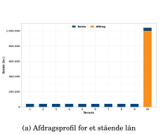
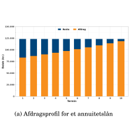
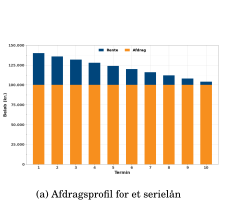
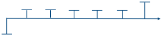
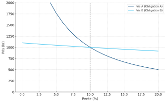
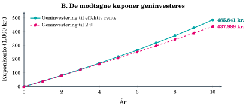

## Afdragsprofilen bestemmer betalingernes timing

::: {.columns}
::: {.column width="33%"}
**Stående lån**

{style="height: 180px; max-height: 180px;"}

Hovedstolen betales ved udløb.
:::
::: {.column width="33%"}
**Annuitetslån**

{style="height: 180px; max-height: 180px;"}

Ydelsen er konstant. Afdraget stiger.
:::
::: {.column width="33%"}
**Serielån**

{style="height: 180px; max-height: 180px;"}

Afdraget er konstant. Ydelsen falder.
:::
:::

Samme hovedstol og kupon kan give forskellige betalingsrækker og dermed forskellig prisfølsomhed og geninvesteringsrisiko.

::: {.notes}
Figurerne viser eksempler på lån med 1 mio. kr. i hovedstol, 10 års løbetid og 4% årlig rente. Annuitetsydelsen er konstant under forudsætning af uændret rente. Tidlige afdrag giver flere penge til geninvestering og reducerer typisk rentefølsomheden sammenlignet med et stående lån.
:::

## Betalingsrækken og værdien i dag

{style="height: 210px; max-height: 210px;"}

Hver betaling $CF_t$ består af rente og eventuelt afdrag. Tidspunktet $t$ bestemmer, hvor længe beløbet skal diskonteres.

$$P_0=\sum_{t=1}^{N}CF_t\,d_t$$

Prisen er summen af betalingernes nutidsværdier. Diskonteringsfaktoren $d_t$ hører til betalingsdatoen.

::: {.notes}
Kontrakten bestemmer betalingsrækken. Diskonteringsfaktorerne omsætter fremtidige beløb til værdi på samme valørdag. For variable eller usikre betalinger skal betalingsrækken først fastlægges eller modelleres. I dette recap illustreres faste, kendte betalinger.
:::

## Pris og effektiv rente

::: {.columns}
::: {.column width="55%"}
{style="height: 360px; max-height: 360px;"}
:::
::: {.column width="45%"}
$$P_0(y)=\sum_{t=1}^{N}\frac{CF_t}{(1+y)^t}$$

Når $y$ stiger, falder værdien af de faste betalinger.

Den 30-årige obligation er mere prisfølsom end den 1-årige. Kurverne er krumme.
:::
:::

Figur 2.10: Begge obligationer har 10% kupon og 1.000 kr. i hovedstol.

::: {.notes}
Figuren viser pris som funktion af én effektiv rente for hver obligation. A har 30 års løbetid og B har ét år. Ved årlige kuponer og indfrielse til pari er prisen P_0(y) = summen af 100/(1+y)^t for t fra 1 til N plus 1.000/(1+y)^N. Ved y = 10% er prisen 1.000 kr. for begge. De faste betalinger diskonteres med den samme y i figuren; det er en pris-rente-sammenhæng, ikke en beskrivelse af en observeret swapkurve. Kapitel 3 udvider beregningen til en diskonteringsfaktor for hver betalingsdato. Krumningen og forskellen i hældning følges op i kapitel 4 om renterisiko.
:::
## Effektiv rente, geninvestering og rentekurven

::: {.columns}
::: {.column width="46%"}
{style="height: 245px; max-height: 245px;"}

**Effektiv rente $y$** er den ene rente, der får betalingsrækkens nutidsværdi til at ramme prisen.
:::
::: {.column width="54%"}
$$P_0=\sum_t\frac{CF_t}{(1+y)^t}$$

Ved hold til udløb afhænger det realiserede afkast også af geninvesteringsrenten.

**Kapitel 3:** En relevant swapkurve omsættes til en diskonteringsfaktor for hver betalingsdato:

$$P_0=\sum_t CF_t d_t,\qquad d_t=\frac{1}{(1+z_t)^t}$$
:::
:::

::: {.notes}
Figuren viser kuponkontoen i kapitel 2's eksempel: ved geninvestering til y er kontoen ved udløb 485.841 kr., ved 2% er den 437.989 kr. Hovedstolen på 1 mio. kr. lægges til i begge tilfælde. YTM er en intern rente beregnet ud fra pris og aftalte betalinger og kræver ikke i sig selv geninvestering. Geninvestering til y er en tilstrækkelig strategi til at opnå y som årligt afkast ved hold til udløb, når betalingerne sker som aftalt og skat og omkostninger ses bort fra. I kapitel 3 udledes diskonteringsfaktorer eller nulkuponrenter fra relevante markedsinstrumenter, fx swaps, og interpoleres til betalingstidspunkterne. En swap-parrente for en løbetid er generelt ikke selv nulkuponrenten for samme løbetid. Kurvevalg og eventuelt kredit- eller likviditetsspænd afhænger af instrumentet og prisningsformålet. Formlen for z_t bruger årlig effektiv rentetilskrivning.
:::

