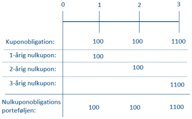
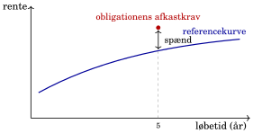

## YTM og renter på tværs af tid

::: {.columns}
::: {.column width="50%"}
**Effektiv rente (YTM)**

$$P_0=\sum_i\frac{CF_i}{(1+y)^{t_i}}$$

Én rente opsummerer prisen på én obligations betalingsrække.
:::
::: {.column width="50%"}
**Nulkuponkurve**

$$P_0=\sum_i\frac{CF_i}{(1+z_i)^{t_i}}$$

Hvert betalingstidspunkt har sin egen nulkuponrente på den valgte kurve.
:::
:::

YTM gengiver prisen, men fortæller ikke alene, hvordan renten varierer med løbetiden.

::: {.notes}
YTM er den rente, som giver den observerede dirty-pris for den konkrete betalingsrække. Den kan bruges til at beregne en sætningsvis diskonteringsfaktor for hver betaling, men disse faktorer bygger alle på den samme rente y. YTM afslører derfor ikke markedsrentens struktur på tværs af løbetider. Sammenlign med nulkuponkurven, hvor z_i er renten til betalingstidspunktet t_i. Formlerne bruger årlige effektive renter.
:::

## Hver betaling har sin egen diskonteringsfaktor

::: {.columns}
::: {.column width="49%"}
{style="height: 340px; max-height: 340px;"}
:::
::: {.column width="51%"}
$$P_0=\sum_i CF_i d(t_i)$$

$$d(t_i)=\frac{1}{(1+z(t_i))^{t_i}}$$

En betaling om 30 år diskonteres med **30-års nulkuponrenten** på den relevante kurve.

Samme betalinger på samme datoer og med samme risiko skal have samme pris.
:::
:::

Nulkupon betyder én betaling ved udløb. Kreditrisiko og renterisiko skal stadig vurderes.

::: {.notes}
Figuren fra kapitel 3 viser, at en kuponobligation kan replikeres med nulkuponbetalinger. Loven om én pris gælder ved et præcist match i betalinger, valuta og relevante risici, under modellens antagelser om handel uden friktioner. Nulkuponobligationens effektive rente er netop dens spotrente ved den anvendte rentekonvention. En kuponobligations YTM opsummerer derimod flere betalingstidspunkter. En nulkuponobligation er ikke automatisk risikofri: kreditrisiko afhænger bl.a. af udstederen, og en lang nulkuponobligation er stærkt rentefølsom. Ved hold til udløb har den ingen kuponer, som skal geninvesteres. Formlen bruger årlige effektive renter og tider målt fra valør. P_0 er dirty-prisen og har samme enhed som betalingerne.
:::

## Bootstrapping udleder de manglende nulkuponrenter

**Input:** markedspriser, kuponer og betalingsdatoer for sammenlignelige instrumenter.

$$100{,}96=105d_1\qquad\Rightarrow\qquad z_1\approx4\%$$

$$101{,}91=6d_1+106d_2\qquad\Rightarrow\qquad z_2\approx5\%$$

| | 1 år | 2 år | 3 år |
|---|---:|---:|---:|
| Kuponobligationens effektive rente | 4,00% | 4,97% | 5,91% |
| Udledt nulkuponrente | 4,00% | 5,00% | 6,00% |

Tidlige betalinger har nu en kendt pris. Resten isolerer næste diskonteringsfaktor. **Interpolation** giver værdier mellem kurvepunkterne.

::: {.notes}
Eksemplet og tabellen er fra kapitel 3: stående lån med årlige terminer og hovedstol 100. Den tredje obligation har kupon 7 og pris 102,92, så 102,92 = 7d_1 + 7d_2 + 107d_3. Priserne er afrundede, hvorfor renterne også angives omtrentligt. Danmark har ikke en fuld række handlede nulkuponobligationer for alle ønskede horisonter. Derfor udledes implicitte nulkuponrenter fra andre instrumenter. Man behøver ikke først beregne YTM eller fysisk strippe obligationerne. Hvis pris er opgivet via YTM, omsættes den til pris med kontraktens betalingskonventioner. Omvendt replikation er mulig ved at kombinere kuponobligationer, eventuelt med korte positioner, så de tidligere betalinger udlignes. I det toårige eksempel trækkes værdien af 6 i år 1 fra prisen, så resten er prisen på 106 i år 2. Sparsomme data kræver også antagelser om interpolation eller kurvetilpasning.
:::

## Swapkurven som referencekurve

En **referencekurve** er den valgte målestok. En swapbaseret kurve er én mulighed, ligesom en stats- eller RTL-/flekskurve.

| Led | Rolle |
|---|---|
| Observerede parswaprenter | Den faste rente, der balancerer swappens to ben |
| Bootstrapping og interpolation | Udleder kurven fra instrumenternes priser og vilkår |
| Nulkuponrenter og diskonteringsfaktorer | Priser betalinger på de enkelte datoer |

Likvide swapinstrumenter giver et praktisk grundlag for **swapkurven**, som vi bruger i kursets videre prisning.

::: {.notes}
Referencekurve beskriver anvendelsen, mens swapkurve beskriver instrumentgrundlaget. De er ikke to kurver, der nødvendigvis ligger oven på hinanden. En RTL-/flekskurve kan estimeres direkte fra relevante realkreditobligationer eller beskrives relativt til en anden reference; den er ikke pr. definition en swapkurve plus et konstant tillæg. Swapmarkedets handlede priser og standardiserede instrumenter er praktiske til kurvebygning, men likviditet varierer med valuta, produkt og løbetid. Undgå at love skarpe priser ved alle horisonter. En parswaprente er ikke nulkuponrenten for samme løbetid. I kapitlets enkle model med én kurve kan swaps bootstrappes direkte. I en model med flere kurver adskilles diskontering fra fremskrivning af fx CIBOR 3M eller 6M. En CIBOR-baseret kurve er ikke automatisk risikofri; IBOR-renter kan indeholde kredit- og likviditetspræmier. OIS er en risikofri tilnærmelse, ikke et løfte om fuldstændigt risikofrie markedsinstrumenter. Kurvevalg afhænger bl.a. af valuta og sikkerhedsstillelse. Kilder: kapitel 3, slides om kursets prisningsgrundlag og referencekurver; Bank of England, Yield curve terminology and concepts, https://www.bankofengland.co.uk/statistics/yield-curves/terminology-and-concepts .
:::

## Teoretisk kurs og markedskurs

::: {.columns}
::: {.column width="50%"}
**Teoretisk kurs**

$$P_{\mathrm{model}}=\sum_i CF_i d_i^{\mathrm{ref}}$$

Hvad er betalingsrækken værd på den valgte referencekurve?
:::
::: {.column width="50%"}
**Markedskurs og effektiv rente**

$$P_{\mathrm{marked}}=\sum_i\frac{CF_i}{(1+y)^{t_i}}$$

Hvilken rente $y$ svarer til markedets pris for obligationen?
:::
:::

En investor kan også bruge sit eget afkastkrav til at beregne den pris, investor højst vil betale.

Forskellen mellem modelkurs og markedskurs kan udtrykkes som et **spænd** til referencekurven.

::: {.notes}
Begge ligninger anvender samme faste betalingsrække og dirty-priser. Sammenlign clean med clean eller dirty med dirty. Modelprisen følger af den valgte referencekurve og eventuelle modelantagelser. Markedskursen er den observerede handels- eller noteringspris; den fastsættes i samspillet mellem købere og sælgere. Investorens ønskede afkastkrav kan omsættes til en maksimal købspris, men er ikke nødvendigvis markedets kurs. Investor kan også vurdere en pris ved hjælp af en kurve plus et ønsket spænd. Spændet kan findes ud fra en given pris, eller en pris kan beregnes ud fra et krævet spænd. Spænd og YTM er ikke samme størrelse: det krævede spænd er ikke nødvendigvis valgt for at opnå en forudbestemt YTM. En given obligations betalingsprofil forbinder pris, YTM og kurvebaseret spænd, men ændrer man betalingsrækken, ændres forbindelsen. En modelkurs kan også være beregnet med et antaget spænd; forskellen mellem pris og modelpris er ikke automatisk fejlpris.
:::

## Spændet måles i forhold til den valgte kurve

::: {.columns}
::: {.column width="45%"}
{style="height: 300px; max-height: 300px;"}
:::
::: {.column width="55%"}
For en fast betalingsrække vælges $s$, så:

$$P_{\mathrm{marked}}=\sum_i\frac{CF_i}{(1+z_i^{\mathrm{ref}}+s)^{t_i}}$$

Et positivt spænd sænker prisen relativt til referencekurven. Spændet kan også være negativt.

Kredit, likviditet og markedsforhold kan forklare forskellen. **Valget af reference påvirker spændet.**
:::
:::

**Kapitel 4:** Hvor meget ændres prisen, når renterne flytter sig? Kurven kan både forskydes og ændre form.

::: {.notes}
Figuren er kapitlets skematiske illustration af referencekurve og spænd. Ligningen definerer et konstant PV-spænd for faste betalinger, med samme årlige rentekonvention for z og s. Det er ikke blot forskellen mellem to obligationers YTM, og det er ikke et kontraktligt kupon-tillæg. P_marked er dirty-prisen. Spændet kan afspejle fælles markeds- og sektorforhold såvel som obligationsspecifikke egenskaber; det er ikke nødvendigvis alene idiosynkratisk kreditrisiko. Referencekurven indeholder allerede nogle præmier. Et negativt spænd kan fx afspejle en særlig efterspørgsel efter sikre og likvide papirer. Kapitel 3's statsobligation handles over modelprisen på swapkurven, så den faste betalingsrække kræver et negativt spænd til at ramme markedet. Et prisgab er ikke automatisk arbitrage, når risiko og egenskaber afviger. Konverterbare obligationer kræver også en model for de ændrede betalinger; det leder til OAS i kapitel 7. Forventninger, løbetidspræmier og udbud/efterspørgsel kan påvirke kurvens dele forskelligt. Det er broen til samlet renterisiko og risiko fordelt på løbetider i kapitel 4.
:::
