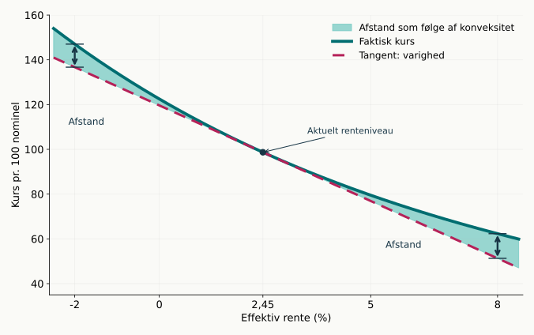
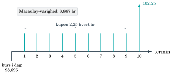
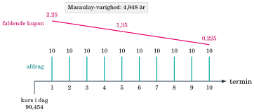
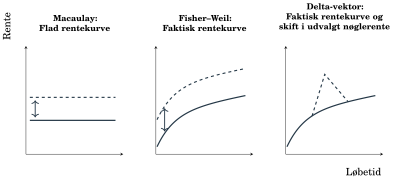
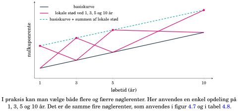
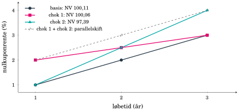
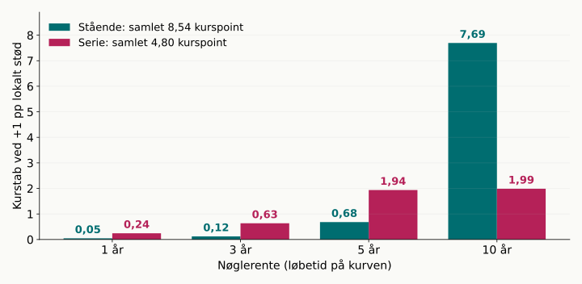
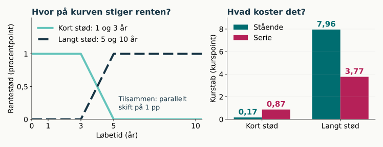

## Renterisiko: samme betalinger, en ny pris

::: {.columns}
::: {.column width="51%"}
{style="height: 365px; max-height: 365px;"}
:::
::: {.column width="49%"}
Når renten stiger, falder nutidsværdien af faste betalinger.

**Varighed** beskriver kurskurvens hældning ved det aktuelle renteniveau.

**Konveksitet** beskriver krumningen og forbedrer estimatet ved større stød.
:::
:::

Selv en obligation med lav kreditrisiko kan få et stort kurstab.

::: {.notes}
Figuren bygger på kapitel 4 og viser den præcise kurs for en stående obligation med 2,25% kupon og ti resterende betalinger, heraf slutbetaling på 102,25. Den effektive rente ændres, mens betalingerne holdes faste. Tangenten er den lokale lineære tilnærmelse. Ved 2,45% er dirty-kursen 98,696. Ved et stød på +1 procentpoint er ændringen −8,122 kurspoint; ved −1 procentpoint er den +8,994. Senere i recap'et stødes kurven i stedet for én effektiv rente.
:::

## Varighed: hvor ligger værdien i tiden?

::: {.columns}
::: {.column width="50%"}
{style="height: 210px; max-height: 210px;"}
**Stående:** varighed 8,867 år
:::
::: {.column width="50%"}
{style="height: 210px; max-height: 210px;"}
**Serie:** varighed 4,948 år
:::
:::

$$D=\sum_i w_i t_i,\qquad w_i=\frac{PV(CF_i)}{P}$$

Begge obligationer har sidste betaling om ca. 10 år. Den **stående obligation** betaler hele hovedstolen på 100 tilbage ved sidste betaling. **Serieobligationen** betaler 10 tilbage hvert år, så investor får en stor del af pengene tidligere, og varigheden bliver kortere.

::: {.notes}
Macaulay-varighed er den nutidsværdivejede gennemsnitlige betalingstid. Begge eksempler har ca. ti år til sidste betaling og 2,25% kupon på restgælden ved 2,45% effektiv rente. Den stående obligation har 81,70% af nutidsværdien i slutbetalingen; serien har mellem ca. 8% og 12% i hver betaling. Varigheden er ikke tidspunktet, hvor hovedstolen er tilbagebetalt. Gem billedet af, hvor værdien ligger: det er præcis det, nøglerenterne senere bygger på.
:::

## Hvorfor er varigheden mindre end 10 år?

**Spørgsmål:** “Jeg får jo først den sidste betaling om 10 år?”

Ja. De 10 år fortæller, hvornår **den sidste betaling** kommer. Varigheden fortæller, hvornår betalingernes **værdi i gennemsnit** kommer.

Først omregnes hver betaling til **nutidsværdi**. Derefter vægtes tidspunktet med betalingens andel af den samlede nutidsværdi.

| | Hvor ligger værdien? | Gennemsnit |
|--|----------|---:|
| **Stående** | 81,7% i slutbetalingen om 9,8 år, resten spredt på kuponerne før | **8,867 år** |
| **Serie** | 8–12% i hver af de ti betalinger fra 0,8 til 9,8 år | **4,948 år** |

Når værdien ligger jævnt fordelt, havner gennemsnittet omkring midten. Når den ligger i én sen betaling, trækkes det mod slutningen.

::: {.notes}
Begge obligationer har sidste betaling omtrent ti år efter valør; første termin ligger 0,811 år ude, sidste 9,811 år ude. Ingen af varighedstallene siger, at låntager har tilbagebetalt hovedstolen efter 8,867 eller 4,948 år, og varigheden er heller ikke tidspunktet, hvor halvdelen er betalt. Regn det for den stående: slutbetalingen alene bidrager med 0,817·9,811 ≈ 8,02 år; de ni kuponer bidrager tilsammen med ca. 0,85 år; i alt 8,867 år. For serien er vægtene næsten ens (fra 12,1% til 8,1%), så gennemsnittet ligger lidt før midtpunktet mellem 0,8 og 9,8 år, fordi de tidlige betalinger er størst. Samme logik som et karaktergennemsnit med ECTS-vægte: et fag med mange point trækker gennemsnittet mod sin karakter. Tallene er fra tabel 4.3 og 4.4, effektiv årlig rente 2,45%.
:::

## Fra varighed til kursændring og kroner

$$MD=\frac{D}{1+y},\qquad \frac{\Delta P}{P}\approx-MD\,\Delta y,\qquad d=\frac{MD\cdot K}{100}$$

| Risikomål | Hvad måler det? | Stående (kap. 4) |
|---|---|---:|
| Modificeret varighed | Procentvis kursændring pr. renteændring | 8,655 |
| Kronevarighed $d$ | Kurspoint ved +1 procentpoint | ca. −8,542 |
| BPV | Kurspoint ved +1 basispunkt | ca. −0,08542 |

Her er $\Delta y$ i decimaltal: 1 procentpoint = 0,01 = 100 basispunkter. For en position ganges med nominel/100.

::: {.notes}
Bogens stående eksempel har D=8,867, effektiv rente 2,45% og dirty-kurs 98,696. MD=8,655 og kronevarighed d=MD·K/100=8,542 kurspoint pr. procentpoint pr. 100 nominel. BPV=d/100. For en position med nominel hovedstol H er BPV i kroner (H/100)·0,08542. Kronevarigheden er den størrelse, nøglerenterne om lidt deler op på løbetider: summen af delta-vektoren er netop d.
:::

## Konveksitet: kursændringen er ikke symmetrisk

::: {.columns}
::: {.column width="48%"}
{style="height: 330px; max-height: 330px;"}
:::
::: {.column width="52%"}
| Rentestød | Faktisk | Kun varighed |
|---|---:|---:|
| −1 procentpoint | +8,994 | +8,542 |
| +1 procentpoint | −8,122 | −8,542 |

Tangenten undervurderer kursen i begge retninger. Konveksitetsleddet anslår afstanden:

$$\Delta K\approx-d\,\Delta y_{pp}+\tfrac12\mathrm{Cvx}_{\mathrm{KR}}(\Delta y_{pp})^2$$

::: {style="font-size: 70%;"}
Med stødet i **procentpoint** får vi:

$$\begin{aligned}
\Delta y_{pp}=-1:\quad \Delta K&\approx-8{,}542\cdot(-1)+\tfrac12\cdot0{,}872\cdot(-1)^2=+8{,}978\\
\Delta y_{pp}=+1:\quad \Delta K&\approx-8{,}542\cdot(+1)+\tfrac12\cdot0{,}872\cdot(+1)^2=-8{,}106
\end{aligned}$$

Estimaterne ligger tæt på de faktiske ændringer i tabellen.
:::
:::
:::

::: {.notes}
Samme stående obligation og basispris 98,696. Kapitel 4's kronekonveksitet på 0,872 giver ΔK ≈ −8,542·Δy_pp + 0,5·0,872·(Δy_pp)^2. Ved +1 pp bliver estimatet −8,106; ved −1 pp +8,978. En konverteringsret kan ændre de forventede betalinger og give lav eller negativ effektiv konveksitet; det kommer i kapitel 6 og 7.
:::

## Ét varighedstal svarer ikke på: hvor på kurven?

{style="height: 300px; max-height: 300px;"}

Venstre: stød til én effektiv rente. Midten: parallelt stød til hele kurven. Højre: stød til **ét område** af kurven.

I praksis flytter kurven sig sjældent parallelt. Korte renter følger pengepolitikken; lange renter afspejler forventninger og løbetidspræmier.

::: {.notes}
Figuren er fra kapitel 4. Varighed og Fisher–Weil svarer på: hvad sker der, hvis hele kurven flytter sig ens? Nøglerenter svarer på: hvad sker der, hvis kun en del af kurven flytter sig? En stejlere eller fladere kurve er netop sådan et skævt stød. To porteføljer med samme samlede varighed kan derfor reagere meget forskelligt.
:::

## Nøglerente: et lokalt stød til ét punkt på kurven

::: {.columns}
::: {.column width="52%"}
{style="height: 330px; max-height: 330px;"}
:::
::: {.column width="48%"}
Stød én nøglerente med 1 procentpoint. Stødet aftager lineært mod nabopunkterne.

**Nøglerentevarighed** = kurstabet i kurspoint ved det lokale stød.

Hver betaling diskonteres med sit eget punkt på kurven. Derfor rammer stødet kun de betalinger, der ligger i området.

Stødene summerer til et parallelt skift, så delta-vektoren summerer til **kronevarigheden**.
:::
:::

::: {.notes}
Nøglerenterne er 1, 3, 5 og 10 år som i kapitel 4. En betaling om 4 år ligger midt mellem 3 og 5 år og får halvdelen af hvert af de to stød. Betalinger før første nøglerente og efter sidste følger den yderste nøglerente fuldt ud. Spørg de studerende: hvilken betaling i den stående obligation rammes af 10-årsstødet? Svaret er slutbetalingen på 102,25, som udgør 81,70% af værdien.
:::

## Bogens eksempel: hvor sidder pengene?

::: {.columns}
::: {.column width="55%"}
{style="height: 330px; max-height: 330px;"}
:::
::: {.column width="45%"}
Treårig stående obligation, 3% kupon, kurve 1%, 2% og 3%.

| | Kort chok | Langt chok |
|---|---:|---:|
| Kursfald | 0,06 | 2,72 |

Hovedstolen kommer i år 3. Derfor er det **det lange chok**, der koster.

Summen 0,06 + 2,72 ≈ 2,78 er kursfaldet ved et parallelt skift.
:::
:::

::: {.notes}
Tallene er fra kapitel 4. Chok 1 løfter 1-årsrenten 1 pp og 2-årsrenten 0,5 pp; chok 2 løfter 2-årsrenten 0,5 pp og 3-årsrenten 1 pp. Samme betalinger, kun kurven ændres. Huskeregel: Find betalingerne med størst nutidsværdi. De afgør, hvilken del af kurven obligationen er følsom over for. Opgave 4.6 øver det samme med 5% kupon.
:::

## Stående og serie har risikoen forskellige steder

{style="height: 345px; max-height: 345px;"}

Den stående obligation har 90% af sin risiko ved 10-årsrenten. Serieobligationens risiko er spredt over hele kurven, fordi den betaler 10 af hovedstolen tilbage hvert år. **Lavere samlet varighed betyder ikke mindre risiko overalt på kurven.**

::: {.notes}
Ny figur til recap'et, beregnet på bogens to obligationer fra tabel 4.3 og 4.4: valør 23. januar 2025, første termin om 296/365 år, 2,25% kupon, flad kurve på 2,45% årlig effektiv. Nøglerenter 1, 3, 5 og 10 år med lineært aftagende stød som figur 4.7. Søjlerne er førsteordens kurstab pr. 100 nominel ved +1 pp lokalt stød. Stående: 0,05 / 0,12 / 0,68 / 7,69, sum 8,54 = kronevarigheden. Serie: 0,25 / 0,64 / 1,94 / 1,99, sum 4,80 = MD·K/100 = 4,948/1,0245·99,454/100. Slutbetalingen i 2034 ligger 9,81 år ude og fordeles derfor med ca. 96% på 10-årspunktet og 4% på 5-årspunktet. Beregning: work/recap04-noeglerenter.py.
:::

## Hvor på rentekurven tager du risiko?

{style="height: 310px; max-height: 310px;"}

| | Kort stød | Langt stød | Parallelt | Andel i kort ende |
|---|---:|---:|---:|---:|
| Stående | −0,17 | −7,96 | −8,12 | 2% |
| Serie | −0,87 | −3,77 | −4,63 | 19% |

Stiger kun de korte renter, taber serieobligationen **fem gange så meget** som den stående obligation, selv om dens samlede varighed kun er godt halvt så stor.

::: {.notes}
Fuld genberegning af kursen, ikke lineær tilnærmelse. Kort stød: 1- og 3-årsnøglerenten +1 pp, dvs. +1 pp ud til 3 år og aftagende til 0 ved 5 år. Langt stød: 5- og 10-årsnøglerenten +1 pp. De to stød summerer til et parallelt skift på 1 pp, og kurstabene summerer derfor næsten til det parallelle tab (forskellen skyldes krumning). Andel i kort ende = kort stød / parallelt stød. Pointe: En investor, der forventer, at Nationalbanken hæver renten, mens lange renter ligger stille, bør se på den korte ende af delta-vektoren, ikke den samlede varighed. Omvendt rammer en stejlere kurve med stigende lange renter den stående obligation hårdest.
:::

## Bro til kapitel 5: hvilke betalinger ejer investor?

Hvor på kurven risikoen ligger, afhænger af **produktet bag obligationen**:

| Lån og obligation (kap. 5) | Betalinger | Hvor ligger renterisikoen? |
|---|---|---|
| F-kort / floater | Kupon fastsættes igen ved hver fixing | Næsten kun i den korte ende |
| RTL (F3, F5) | Fast kupon til refinansiering | Omkring 3 eller 5 år, som en stående obligation |
| Fastforrentet konverterbar | Annuitet over 30 år, kan indfries til kurs 100 | Spredt over kurven; betalingerne kan ændre sig |

Kapitel 5: hvordan lånene bliver til obligationer. Kapitel 6 og 7: hvad konverteringsretten gør ved betalinger, pris og risiko.

::: {.notes}
Figurer og produktbeskrivelser ligger i kapitel 5: F-kort er låneproduktet, FLT er obligationen; uden triggers ligner RTL en stående kuponobligation frem til refinansieringen. For en floater er kursfølsomheden over for renten tæt på tiden til næste rentefixing, mens tillæg og spænd giver en separat følsomhed. Den fastforrentede konverterbare obligation har en betalingsrække, der afhænger af låntagernes indfrielser: ved rentefald kan betalinger rykkes frem, og så flytter risikoen sig på kurven. Derfor er en fast betalingsrækkes varighed og delta-vektor et udgangspunkt, ikke en fuld model for konverteringsrisiko.
:::
