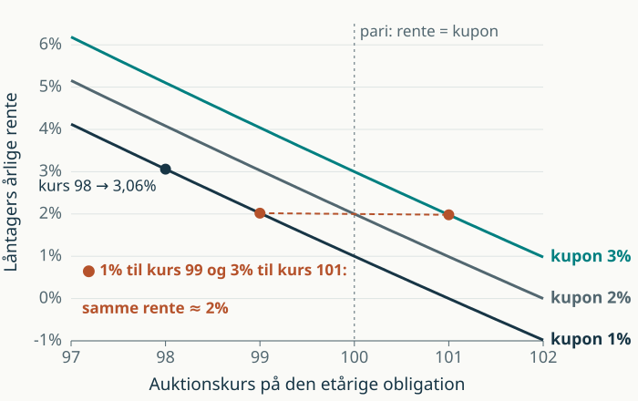

<!--
To slides til recap 5–6, indsat lige efter "RTL: fast rente frem til næste refinansiering".
Figur: scripts/make_recap05_f1_figure.py → images/final/recap05-f1-rente-kurs.svg.
Talgrundlag: F1 R = (1+c)/k − 1. F3 lån A er Astrup Jensen (2020), eks. 11.4; lån B er konstrueret med lavere kurser.
-->

## F1: auktionskursen bestemmer låntagers rente

::: {.columns}
::: {.column width="45%"}
$RG_0$ er beløbet, låntager får udbetalt. Instituttet sælger $N$ nominelt af én etårig obligation med kupon $c$ til kurs $k_0$.

År 0: $k_0N=RG_0$\
År 1: $(1+c)N=(1+\bar R)RG_0$

$$\bar R=\frac{\overbrace{c}^{\text{kupon}}+\overbrace{(1-k_0)}^{\text{kurstab}}}{\underbrace{k_0}_{\text{udbetalt}}}$$
:::
::: {.column width="55%"}
{style="height: 300px; max-height: 300px;" fig-alt="Låntagers F1-rente som funktion af auktionskursen for kupon 1, 2 og 3 procent."}

Pr. 100 kr. nominelt med kupon 1% og kurs 99: låntager får 99 kr. udbetalt og betaler 1 kr. i kupon + 1 kr. i kurstab, altså $2/99=2{,}02\%$.
:::
:::

**Lav kurs → højere rente.** Ved samme kurs giver en højere kupon en højere rente, men investor betaler mere for en høj kupon: 1% til kurs 99 ≈ 3% til kurs 101.

::: {.notes}
Isolér N i år 0 og sæt ind i år 1: RG0 går ud, og R = (1+c)/k0 − 1 = (c + (1 − k0))/k0. Tæller og nævner er pr. 1 kr. nominelt. Det er den etårige obligations effektive rente, y_1 i kursformlen på forrige slide. Med RG0 = 1 mio. kr., c = 1% og kurs 99 skal der udstedes N = 1.010.101 kr. nominelt; låntager betaler 20.202 kr. i rente, og ny funding giver 1 mio. kr. Kurstabet på 1 kurspoint betales over ét år. Kurs 98 giver 3,06%. Høj kupon: investor betaler overkurs, så 3% til kurs 101 (1,98%) koster næsten det samme som 1% til kurs 99 (2,02%). Samme kupon: lavere kurs → højere rente. Samme kurs: højere kupon → højere rente. Renten er før bidrag.
:::

## F3: samme logik med tre obligationer

Excel-arkets ligningssystem sørger kun for, at betalingerne passer hvert år. Renten drives af kurserne.

| Kupon 1% på alle | Kurs 1-årig | Kurs 2-årig | Kurs 3-årig | Eff. rente 3-årig | Låntagers rente $\bar R$ |
|---|---:|---:|---:|---:|---:|
| Lån A (bogen) | 99,0 | 97,5 | 96,0 | 2,398% | **2,395%** |
| Lån B (ringere auktion) | 98,5 | 96,0 | 94,0 | 3,126% | **3,122%** |

Lavere kurs → mere nominelt skal udstedes for at skaffe $RG_0$ → mere skal betales tilbage via renten.

Den treårige obligation skaffer 96–97% af provenuet, så $\bar R$ ligger tæt på dens effektive rente, men lidt under, fordi de korte obligationer har lavere renter.

De to små obligationer sælges også ved lånets start, typisk ved at udstede flere af stående obligationer, der allerede handles i markedet. De får betalingerne til investorerne i år 1 og 2 til at matche låntagers faste ydelse.

::: {.notes}
Lån A er Astrup Jensen (2020), eksempel 11.4: N1 = 13.541, N2 = 13.676, N3 = 1.013.813 kr. og R = 2,3951%. Lån B med samme opskrift: N1 = 20.594, N2 = 20.800, N3 = 1.021.008 kr. og R = 3,1218%. Effektive renter på de korte obligationer: A 2,02% og 2,29%, B 2,54% og 3,09%. Uden hjælpeobligationerne ville låntagers ydelse i år 1 og 2 (ca. 2,4% af RG0) overstige kuponen på den treårige (ca. 1%), så ind- og udbetalinger ikke matchede. Overskuddet bruges til at indfri de små obligationer, så kurstabet fordeles jævnt over de tre år.
:::
