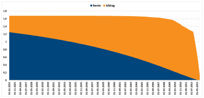
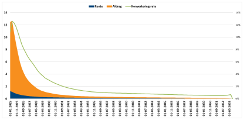
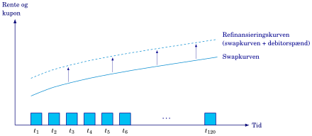
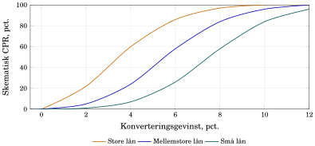
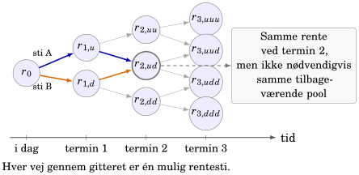

## Ved konvertering får investor hovedstolen tidligere

::: {.columns}
::: {.column width="50%"}
**Uden konvertering**

{style="height: 285px; max-height: 285px;" fig-alt="Ordinære renter og afdrag på 5% NYK 2053 uden konvertering."}
:::
::: {.column width="50%"}
**Med konvertering**

{style="height: 285px; max-height: 285px;" fig-alt="Modelestimerede betalinger på samme obligation med tidlige indfrielser."}
:::
:::

5% NYK 2053, pr. 100 nominel fra 1. januar 2025. **Akserne har forskellig skala.** Den grønne rates periode er ikke dokumenteret. Kilde: Vitec Scanrate.

Når låntager indfrier, bortfalder de senere renter og afdrag på lånet. Investor skal ofte geninvestere pengene til en lavere rente.

::: {.notes}
Recap af kapitel 6 og overgang til kapitel 7. Sammenlign betalingstidspunkter og den lange hale, ikke søjlernes højder direkte. Figuren til venstre har en venstre akse til 1,8, figuren til højre til 14. Den grønne leverandørrates periode er ikke dokumenteret og skal ikke aflæses som kapitlets kvartals-CPR. Begge figurer er fra den aktive bogs kapitel 6. Låntager har retten til pariindfrielse; investor ejer derfor en betalingsrække, som låntager kan afbryde. Spørg: Hvorfor er en høj kupon mindre værd, hvis låntager kan indfri netop efter et rentefald?
:::

## Hvad får investor udbetalt ved 3% CPR?

**CPR** er den indfriede andel af den planlagte restgæld efter ordinært afdrag. Her er alle rater pr. kvartal.

::: {.columns}
::: {.column style="width: 56%; font-size: 26px;"}
$$\begin{aligned}
EXT_t&=CPR_t(1-ORD_t)\\
&=0{,}03(1-0{,}004)=0{,}02988
\end{aligned}$$

$$\begin{aligned}
UDT_t&=ORD_t+EXT_t\\
&=0{,}004+0{,}02988=0{,}03388
\end{aligned}$$

$$\begin{aligned}
CF_t&=I_t+N_{t-1}UDT_t\\
&=1{,}25+100\cdot0{,}03388=4{,}638
\end{aligned}$$

$$\begin{aligned}
N_t&=N_{t-1}(1-UDT_t)\\
&=100(1-0{,}03388)=96{,}612
\end{aligned}$$
:::
::: {.column style="width: 44%; font-size: 26px;"}
**Begyndelsesrestgæld $N_{t-1}=100$**

$ORD=0{,}4\%$, $CPR=3\%$, $I_t=1{,}25$.

| Betaling / restgæld | Beløb |
|---|---:|
| Ordinært afdrag $100\cdot0{,}004$ | 0,400 |
| Ekstraordinært udtræk $100\cdot EXT_t=100\cdot0{,}02988$ | 2,988 |
| Rente (oplyst) | 1,250 |
| **Samlet betaling, $CF_t$** | **4,638** |
| **Restgæld bagefter, $N_t$** | **96,612** |

$ORD$, $EXT$ og $UDT$ er andele af begyndelsesrestgælden. $I_t$ er rentebetalingen.
:::
:::

::: {.notes}
Kilde: kapitel 6, afsnittet om CPR, ORD, EXT og UDT. Rater indsættes som decimaltal. ORD, EXT og UDT har begyndelsesrestgælden som nævner; CPR har den planlagte restgæld efter ordinært afdrag. UDT er 3,388%, mens CPR er 3%. Det er en regnskabsmæssig opdeling af indfrielsen; låntager træffer ét valg om hele lånet. CPR tæller gæld, ikke antal låntagere. CK95 giver allerede offentliggjort udtræk for nærmeste termin. Senere terminer kræver modelskøn. Ved konstant kvartals-CPR på 3% er årsækvivalenten 1-(1-0,03)^4 = 11,47%. Datakildens ratekonvention og feltdefinitioner skal kontrolleres før brug.
:::

## Gain måler besparelsen i nutidsværdi

::: {.columns}
::: {.column width="47%"}
{style="height: 310px; max-height: 310px;" fig-alt="Swapkurve og refinansieringskurve med debitorspænd over lånets betalinger."}

**Refinansieringskurven** er swapkurven plus debitorspænd. Et højere spænd gør det dyrere at omlægge lånet og mindsker besparelsen.
:::
::: {.column width="53%"}
$$Gain_t=\frac{PV_{\text{continue},t}-100(1+cost_t)}{PV_{\text{continue},t}}$$

$PV_{\text{continue}}$: gamle betalinger diskonteret på refinansieringskurven. $cost$: omkostninger som andel af indfrielsesbeløbet.

Med nutidsværdi 110 og omkostninger 2%:

$$Gain=\frac{110-102}{110}=7{,}27\%$$

Låntagerne har forskellige gevinstkrav. Nogle venter på en bedre rente, selv om de kan spare ved at omlægge nu.
:::
:::

::: {.notes}
Kilde: kapitel 6, refinansieringsgevinst og gevinstkrav. Alle værdier er pr. 100 restgæld. Gevinsten er 8 i nutidsværdi og 7,27% målt i forhold til fortsættelsesværdien. Den er hverken 8% af restgælden eller investors optionsværdi. Eksemplet ser bort fra ændret bidrag, skat og låneprofil. Refinansieringskurven z_refi = z_swap + s_debitor beskriver låntagers alternativ; låntager kan ikke normalt låne direkte til swaprenten. Ved højere kurve falder nutidsværdien af de gamle betalinger, og Gain falder. En mulig beslutningsregel er Gain >= låntagers gevinstkrav. Allerede medregnede omkostninger skal ikke medregnes igen i gevinstkravet. Ventetid kan spare en omlægningsrunde, men koster fortsatte høje ydelser og indebærer risiko for at miste muligheden.
:::

## Samme gevinst giver forskellig CPR

::: {.columns}
::: {.column width="55%"}
{style="height: 350px; max-height: 350px;" fig-alt="Tre låntagergruppers illustrative kvartals-CPR som funktion af refinansieringsgevinsten."}

Skematiske gruppekurver fra kapitel 6.
:::
::: {.column width="45%"}
Gain er her beregnet med samme omkostningssats for alle grupper. Faste omkostninger, som ikke er med i Gain, fylder mindre ved store lån.

I **miksturmodellen** vægter vi hver gruppes CPR med dens andel af gælden:

$$CPR_t=\sum_j w_{j,t}c_{j,t}$$

$c_j$: gruppens CPR. $w_j$: gruppens andel af restgælden efter ordinært afdrag.

CK92 giver fordelingen. Modellen skønner gruppernes CPR.
:::
:::

::: {.notes}
Kilde: kapitel 6, låntagergrupper og miksturmodel. Aflæs kurverne ved én fælles Gain og spørg, hvorfor seriens CPR afhænger af vægtene. Figuren er illustrativ, ikke en estimering ud fra CK92 alene. Vægtene skal summere til én og gælde samme termin som gruppernes rater. Hvis ordinære afdrag varierer på tværs af grupper, opdateres vægtene til restgælden efter planlagt afdrag. Forskelle i lånestørrelse forklarer ikke al adfærd; omkostninger, opmærksomhed, privat/erhverv og ventemulighed kan også spille ind. CK95 viser udtræk; CK92 viser sammensætning.
:::

## Burnout: de hurtigste låntagere har allerede indfriet

::: {.columns}
::: {.column width="52%"}
{style="height: 335px; max-height: 335px;" fig-alt="To rentestier ender ved samme korte rente efter forskellig rentehistorik."}

Selv ved samme rente på termin 2 kan der være forskellige låntagere tilbage på de to stier.
:::
::: {.column width="48%"}
Ved et tidligt rentefald indfrier de mest konverteringsvillige låntagere ofte først.

De tilbageværende låntagere kan derfor reagere mindre på samme Gain. Det kaldes **burnout**.

For en lukket pulje, med $B_0=1$:

$$B_t=B_{t-1}(1-CPR_t)$$

Jo lavere $B$, desto større tidligere konverteringer. Ordinære afdrag indgår ikke i $B$.
:::
:::

::: {.notes}
Kilde: kapitel 6, burnout og rentestier. B er en forkortelse for bogens Burnout-indikator. Den er et historikmål, ikke en optælling af lån eller den faktiske restgæld. Poolfaktoren beskriver seriens størrelse og påvirkes også af ordinære afdrag. Selektionsvirkningen opstår både mellem grupper og inden for en gruppe; det er ikke nødvendigvis den enkelte låntager, der ændrer adfærd. Beregn først terminens CPR ud fra den hidtidige historik, derefter betaling, restgæld og ny B. Figuren viser korte renter; rentemodellen leverer også renter for andre løbetider. Rentemodellen kalibreres til dagens kurve og antagelser om rentebevægelser. Samme korte rente er ikke i sig selv ensbetydende med samme refinansieringsvilkår. Pointen er, at selv ved samme senere Gain kan historikken give forskellig CPR.
:::

## Hvad får CPR til at stige eller falde?

$$CPR_t=g\!\bigl(\underbrace{Gain_t}_{+},\quad
\underbrace{T-t}_{-},\quad
\underbrace{B_{t-1}}_{+},\quad
\text{låntagersammensætning}\bigr)$$

Fortegnet viser virkningen på CPR, når et input stiger, og de øvrige holdes fast.

- **Gain (+):** Flere låntagere når deres gevinstkrav.
- **Tid til udløb (−):** Mere tid til at vente på en bedre mulighed.
- **B (+):** Mindre udbrændt pulje med flere konverteringsvillige lån.
- **Flere lån med lave gevinstkrav (+):** Flere reagerer ved den aktuelle Gain.

**Minusset på tid til udløb gælder ved samme Gain** og bygger på værdien af at vente. Besparelsen over de resterende år er allerede med i Gain.

::: {.notes}
Fortegnene er økonomisk intuition for den valgte adfærdsmodel, ikke universelle empiriske koefficienter. Restløbetidens negative fortegn er betinget af samme Gain og en model, hvor længere restløbetid øger værdien af at vente på en bedre konverteringsmulighed. Ved uændrede øvrige lånevilkår kan restløbetiden også ændre Gain; den effekt skal holdes adskilt fra den direkte effekt ved fast Gain. Bogens generelle funktion fastlægger ikke et universelt fortegn for denne ekstra restløbetidseffekt. B er bogens burnoutindikator fra den foregående slide: høj B betyder mindre tidligere konvertering og typisk større konverteringspres ved samme Gain. CPR beregnes med B ved terminens begyndelse, og B opdateres bagefter. Poolfaktoren er ikke det samme mål, da den også påvirkes af ordinære afdrag og eventuelle nyudstedelser. Højere debitorspænd reducerer typisk CPR gennem lavere Gain og skal ikke tælles som en ekstra uafhængig effekt her. Låntagersammensætningen består af gruppevægte, der summerer til én; plusset i tabellen gælder, når vægt flyttes til grupper med lavere gevinstkrav.
:::

## Kapitel 7: usikre betalinger, kurs og nøgletal

I kapitel 6 brugte vi konverteringsmodeller til at **skønne CPR**. Det giver et bud på, hvor meget investor får udbetalt, og hvornår.

Hvis flere låntagere indfrier, får investor hovedstolen tidligere, og de senere renter falder bort. Derfor påvirker konverteringerne både **kursen og risikoen**.

I kapitel 7 bruger vi modellen til at undersøge:

| | Hvad vil vi vide? |
|---|---|
| **Kurs og optionsværdi** | Hvad er betalingerne værd, når låntager kan indfri før tid? |
| **OAS** | Hvilket spænd får modelprisen til at svare til markedskursen? |
| **Varighed og konveksitet** | Hvordan ændres kursen, når renten ændrer sig? |

Ved en renteændring skal vi også tage højde for, at låntagerne kan konvertere anderledes. **Betalingerne kan ændre sig sammen med renten.**

::: {.notes}
Broen skal samle formålet med kapitel 6 og åbne spørgsmålene i kapitel 7. Investor kender den ordinære betalingsplan, men fremtidige indfrielser gør de faktiske betalinger usikre. Konverteringsmodellen giver et skøn for CPR, som omsættes til betalinger og restgæld. Allerede offentliggjort udtræk for nærmeste termin er kendt. Kapitel 7 bruger modellen til prisfastsættelse og nøgletal. Optionsværdien beskriver forskellen mellem en sammenlignelig inkonverterbar og konverterbar obligation. OAS forbinder modelprisen med markedskursen. Ved beregning af renterisiko må både diskontering og konverteringsadfærd indgå. En høj kupon er kun værdifuld, så længe investor modtager den. Den numeriske prisningsmetode gennemgås i kapitel 7 og er ikke nødvendig for denne overgang.
:::
