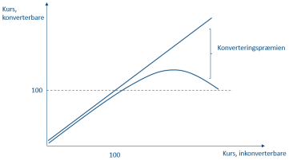
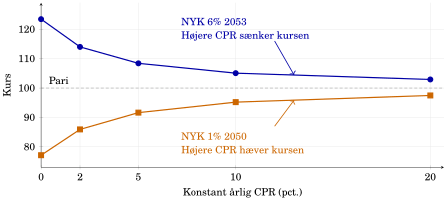

## Betaling og diskontering hører til samme rentesti

Låntager indfrier efter rentefald og lader lånet løbe efter rentestigninger. Investor får altså pengene tilbage, når renten er lav.

| Sti | $CF_1$ | $CF_2$ | $DF_1$ | $DF_2$ | Stiværdi |
|---|---:|---:|---:|---:|---:|
| A: lav rente fra termin 1 | 101,25 | 0 | 0,990 | 0,985 | 100,2375 |
| B: høj rente fra termin 1 | 1,25 | 101,25 | 0,990 | 0,975 | 99,95625 |

Første periodes rente er kendt i dag, så $DF_1$ er ens. Ved termin 1 går renten for næste periode til 0,51% på A og 1,54% på B. Den nye rente styrer både indfrielsen og $DF_2$.

$$P_{\text{model}}=\sum_m\pi_m\sum_t DF_t^{(m)}CF_t^{(m)}=0{,}50\cdot100{,}2375+0{,}50\cdot99{,}95625=100{,}10.$$

Gennemsnitlig betaling gange gennemsnitlig diskonteringsfaktor giver 100,35. Den sene betaling på 101,25 findes kun på sti B, hvor $DF_2$ er lavest.

::: {.notes}
Recap af kapitel 7 og overgang til kapitel 8. Kilde: kapitel 7, eksemplet med to kvartaler, restgæld 100, kvartalskupon 1,25 og prisningsvægt 0,50 på hver sti. Stiværdierne er 0,990·101,25 og 0,990·1,25 + 0,975·101,25. Perioderenterne kan aflæses af faktorerne: første periode 1/0,990 − 1 = 1,01% på begge stier; anden periode 0,990/0,985 − 1 = 0,51% på A og 0,990/0,975 − 1 = 1,54% på B. DF_1 kan ikke afhænge af stien, fordi første periodes rente er kendt i dag. Låntager indfrier ved termin 1, fordi hun kan refinansiere den resterende periode til den nye, lave rente. Hele forskellen på ca. 0,25 kurspoint opstår på anden termin: gennemsnitsmetoden giver 0,980·50,625 = 49,61, mens den korrekte værdi er 0,50·0,975·101,25 = 49,36. Vægtene er prisningsvægte fra rentemodellen og ikke prognoser for faktiske renteforløb. Samme samvariation mellem betalinger og renter forklarer senere den lave varighed og den negative konveksitet. Spørg: Hvorfor er anden betaling nul på sti A?
:::

## Investor har solgt låntager en call-option

::: {.columns}
::: {.column width="44%"}
{style="height: 300px; max-height: 300px;" fig-alt="Skematisk sammenhæng mellem inkonverterbar og konverterbar kurs. Afstanden mellem de to er optionsværdien."}

Skematisk. Afstanden mellem linjen og kurven er optionsværdien.

Kurs 100 er intet fast loft: omkostninger, træghed og værdien af at vente forsinker indfrielsen.
:::
::: {.column width="56%"}
$$V_{\text{call}}=P_{\text{inkonv}}-P_{\text{konv}}$$

Begge priser gælder samme kupon, ordinære afdrag, udløb, kurve og spænd. Forskellen måles i kurspoint.

| Nykredit 2053 | Konv. | Inkonv. | Call, point |
|---|---:|---:|---:|
| 6% | 103,07 | 145,35 | 42,28 |
| 5% | 102,09 | 131,74 | 29,65 |
| 1% | 79,91 | 85,25 | 5,34 |

Højkuponens option er tættest på at være i pengene. Lavkuponen kræver et stort rentefald, før indfrielse til 100 kan betale sig.
:::
:::

::: {.notes}
Kilde: kapitel 7, konverteringsretten og optionsværdien. Konvertering forsinkes også af opsigelsesvarsler, skat og rådgivning. Tabellen er Vitec Scanrates modelberegning for Nykredit 11. oktober 2024. Relativt til den konverterbare kurs er optionsværdien 41,0%, 29,0% og 6,7%. Modellen beregner betalingerne direkte; optionsværdien er en fortolkning af forskellen bagefter. Figuren kalder samme forskel konverteringspræmien. Risikoeksemplet senere bruger et separat modeludtræk for 5% NYK 2053 med inkonverterbar værdi 131,01 og optionsværdi 28,92; de to tal skal holdes adskilt fra tabellens 29,65.
:::

## OAS får modelprisen til at ramme markedskursen

$$P_{\text{model}}(OAS)=\sum_m\pi_m\sum_t DF_t^{(m)}(OAS)\,CF_t^{(m)}=P_{\text{market}}$$

- Konverteringsretten ligger allerede i betalingerne $CF_t^{(m)}$.
- Under kalibreringen holdes rentestier og betalinger fast. Kun diskonteringen ændres.
- Er modelprisen for høj, skal OAS op. Er den for lav, skal OAS ned.

Et PV-spænd fra kapitel 3 lægges på én kendt betalingsrække. OAS lægges på betalinger, som en rente- og konverteringsmodel har beregnet. Derfor er OAS **modelafhængigt**: rammer modellen indfrielserne forkert, havner fejlen i spændet.

Én markedskurs kan ikke bestemme både CPR og OAS. Er modelprisen 105 og markedskursen 101, kan forskellen lukkes med et højere OAS eller med mere indfrielse.

::: {.notes}
Kilde: kapitel 7, OAS-kalibrering og modelafhængighed. OAS kan afspejle kreditrisiko, likviditet, udbud og efterspørgsel samt modelfejl. Fortolkningen som ekstra kompensation gælder givet modellen og referencekurven. Negativt OAS betyder en høj pris relativt til modellen ved OAS = 0; risikoen er stadig til stede. Markedsimplicit prepayment fastholder OAS og justerer adfærden, til modellen rammer kursen (Cheyette, 1996). En prisningskonsistent konverteringsantagelse er ikke i sig selv en prognose for faktiske indfrielser.
:::

## Varigheden er lav, fordi betalingerne følger renten

Ved et parallelt stød til swapkurven beregnes CPR og betalinger igen. OAS holdes fast på den kalibrerede værdi.

$$KV\approx-\frac{P_0(+\Delta y)-P_0(-\Delta y)}{2\Delta y\cdot100},\qquad
\Delta P\approx-KV\,\Delta y_{\text{pp}}+\tfrac12\mathrm{Cvx}_{\mathrm{KR}}(\Delta y_{\text{pp}})^2$$

$\Delta y$ er i decimaltal (15 bp = 0,0015), $\Delta y_{\text{pp}}$ i procentpoint (15 bp = 0,15).

| 5% NYK 2053 | KV | Kronekonveksitet | 15 bp ned | 15 bp op |
|---|---:|---:|---:|---:|
| Konverterbar | 1,43 | −2,92 | +0,18 | −0,25 |
| Inkonverterbar | 15,50 | 2,79 | +2,36 | −2,29 |

Ved rentefald indfrier flere, og den høje kupon forsvinder. Ved rentestigning bliver obligationen længere. Gevinsten ved fald er derfor mindre end tabet ved stigning: **negativ konveksitet**. Varigheden er stadig positiv.

::: {.notes}
Kilde: kapitel 7, rentestød, KV og konveksitet. Modeludtræk fra Vitec Scanrate, 11. oktober 2024. Modelpriserne er 101,84 ved +15 bp og 102,27 ved −15 bp. Kursændringerne i tabellen er beregnet med varighed og konveksitet og står i kurspoint. Relativt til startkursen er de +0,18% og −0,24% for den konverterbare og +1,80% og −1,75% for den inkonverterbare. Genkalibreres OAS til den gamle kurs efter stødet, skjules prisfølsomheden. En Macaulay-varighed på en fast betalingsrække overser adfærdskanalen. Negativ konveksitet er ikke negativ varighed: negativ varighed betyder, at et lille rentefald sænker kursen. Lav KV betyder heller ikke, at renterisikoen er forsvundet: ved store rentestigninger kommer serien til at ligne en lang inkonverterbar obligation.
:::

## Mere indfrielse: lavere kurs over pari, højere under pari

::: {.columns}
::: {.column width="55%"}
{style="height: 330px; max-height: 330px;" fig-alt="Mere pariindfrielse sænker højkuponens kurs og løfter lavkuponens kurs."}

Modelberegning 4. september 2026. Kurver og OAS er faste; kun CPR ændres.
:::
::: {.column width="45%"}
Indfrielse til 100 bytter de resterende betalinger ud med 100 nu.

**Over pari** er de resterende betalinger mere værd end 100. Investor mister attraktive kuponer.

**Under pari** er de mindre værd end 100. Tidlig betaling af 100 er en gevinst.

| Årlig CPR | 6% 2053 | 1% 2050 |
|---|---:|---:|
| 0% | 123,44 | 77,14 |
| 10% | 105,06 | 95,20 |
:::
:::

::: {.notes}
Kilde: kapitel 7, CPR-forsøget med NYK 6% 2053 og NYK 1% 2050. Kalibreringskurserne var 105,825 og 76,750; derefter pålægges konstante årlige CPR-rater uden genkalibrering af OAS. Årlig CPR omregnes til kvartaler med 1 − (1 − 0,10)^(1/4) ≈ 2,60%. KV falder i begge serier, når CPR stiger (6%: 11,45 til 2,34; 1%: 7,41 til 2,03), fordi betalingerne kommer tidligere. For 1% 2050 er delivery option slået fra, så forsøget isolerer pariindfrielse; i praksis kan låntager købe obligationer tilbage under pari. Forsøget er et kontrolleret scenarie og ikke en prognose for indfrielse under kurs 100.
:::

## Debitorspænd og OAS: samme stød, modsat fortegn

NYK 6% 2053, 4. september 2026, startkurs 105,825.

| +100 bp i | Hvad flytter sig? | CPR, fire terminer | Kursændring, point |
|---|---|---:|---:|
| Debitorspænd | Låntagers refinansieringskurve | 32,08% → 13,87% | +3,08 |
| OAS | Investors diskontering | 32,11% → 32,11% | −3,09 |

Dyrere refinansiering giver lavere Gain og færre indfrielser, så investor beholder den høje kupon længere. Et højere OAS diskonterer de samme betalinger hårdere.

::: {.columns}
::: {.column width="50%"}
**Spørg, hvor ændringen sættes ind:**

- Rente: nye betalinger og ny diskontering.
- CPR: betalingerne direkte.
:::
::: {.column width="50%"}
&nbsp;

- Debitorspænd: Gain → CPR → betalinger.
- OAS: kun diskonteringen.
:::
:::

::: {.notes}
Kilde: kapitel 7, de fire stød og forsøgene med debitorspænd og OAS. Hvert forsøg har sin egen kalibrering. Ved −100 bp i debitorspændet stiger CPR til 53,56%, og kursen falder 1,90 point; lige store stød giver altså forskellige kursændringer. OAS-forsøget er kalibreret igen til 105,825 med indfrielse via markedskursopkøb slået fra. Derfor står der 32,11% og ikke 32,08%, og de to forsøg kan ikke læses som kolonner i samme beregning. Uændret CPR over fire terminer dokumenterer ikke alene uændrede betalinger over hele løbetiden. For en lavkupon langt under pari kan et ændret debitorspænd have lille effekt, fordi refinansiering stadig ikke kan betale sig.
:::

## Kapitel 8: hvad tjener investor over en horisont?

Kapitel 7 prisfastsatte obligationen i dag. Kapitel 8 måler afkastet over en periode:

$$HPR_{0,h}=\frac{K_h^{dirty}+FV_h(CF)-K_0^{dirty}}{K_0^{dirty}}$$

For en konverterbar obligation bygger betalinger og slutkurs på kapitel 6 og 7:

- **Betalingerne undervejs** følger CPR. Er obligationen købt over pari, taber investor på hvert udtræk til 100.
- **Slutkursen** afhænger af kurve, OAS og konverteringsadfærd på horisontdagen.

Kursændringen kan fordeles på de kanaler, kapitel 7 stødte hver for sig:

$$\Delta P\approx\Delta P^{\mathrm{tid}}+\Delta P^{\mathrm{kurve}}+\Delta P^{\mathrm{OAS}}+\Delta P^{\mathrm{vol}}+\Delta P^{\mathrm{prepayment}}$$

::: {.notes}
Kilde: kapitel 8, afkastmåling og FIPA. Kapitel 8 bruger K for markedskurs og P for modelpris eller nutidsværdi. FV_h(CF) er betalingerne undervejs, eventuelt geninvesteret frem til horisonten. Der regnes med dirty kurser, fordi vedhængende rente er en faktisk betaling. Babcock-formlen i kapitel 8 bruger Macaulay-varighed og gælder inkonverterbare obligationer; for konverterbare bruges den modelbaserede varighed fra kapitel 7. Volatilitet blev ikke stødt i kapitel 7; den ligger i rentemodellen og får sit eget led i attributionen. Spørg: Hvilke af kapitel 7's stød hører til leddet for prepayment, og hvilket til OAS-leddet?
:::
