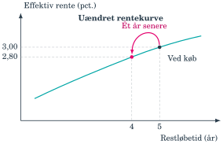
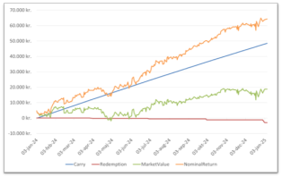
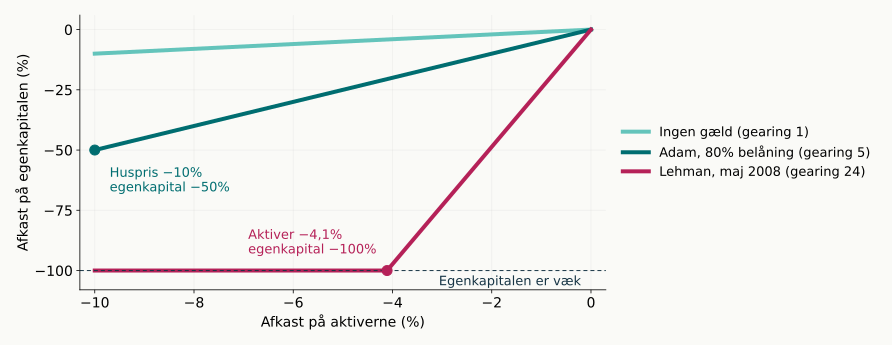

## Afkast måles med dirty kurser

::: {.columns}
::: {.column width="46%"}
$$HPR_{0,h}=\frac{K_h^{dirty}+FV_h(CF)-K_0^{dirty}}{K_0^{dirty}}$$

Køber betaler dirty kurs, og sælger modtager dirty kurs. $FV_h(CF)$ er kupon, afdrag og udtræk undervejs, eventuelt geninvesteret.

$$HPR^{ann}_{0,h}=(1+HPR_{0,h})^{1/h}-1$$
:::
::: {.column width="4%"}
:::
::: {.column width="50%"}
Kupon 4, et halvt år, samme clean kurs ved køb og salg:

| | Køb | Salg |
|---|---:|---:|
| Clean kurs | 102,50 | 102,50 |
| Vedhængende rente | 3 | 1 |
| Dirty kurs | 105,50 | 103,50 |

$$HPR=\frac{103{,}50+4-105{,}50}{105{,}50}=1{,}90\%$$

Annualiseret 3,83%. Investor modtager 4 i kupon, men tjener 2 kurspoint i ejerperioden.
:::
:::

::: {.notes}
Kilde: kapitel 8, eksemplet med 30/360 og 270 og 90 dage siden seneste kupon. Kuponen betales efter tre måneder, salget sker tre måneder senere. De 2 af kuponen, som ikke er indtjening, betalte investor til sælger som vedhængende rente ved købet. Annualisering: (1 + 2/105,50)^2 − 1 = 3,83%. Spørg: hvad bliver afkastet, hvis man fejlagtigt regner med clean kurser?
:::

## Tre afkastbegreber svarer på tre spørgsmål

| Begreb | Spørgsmål |
|---|---|
| Effektiv rente (YTM) | Hvilken rente passer betalingsrækken til dagens pris? |
| Forventet horisontafkast | Hvad bliver afkastet under vores antagelse om exit og geninvestering? |
| Realiseret afkast | Hvad tjente investor faktisk? |

Et forventet horisontafkast kræver en **exit-kurs**. Statsobligationen i kapitel 8 købes til 105,25 og sælges på kupondagen til en antaget exit-rente på 3,35%:

$$HPR=\frac{105{,}447+4-105{,}25}{105{,}25}\approx3{,}99\%,\qquad HPR^{ann}\approx5{,}37\%$$

::: {.notes}
Kilde: kapitel 8. Horisonten er 273/365 år, og exit-kursen 105,447 er nutidsværdien af de ti resterende betalinger ved 3,35%. Kuponen på horisontdagen står uden for exit-kursen, så den ikke tælles to gange. 3,35% er en antagelse om fremtidig prisning; 5,37% er et forventet annualiseret afkast. YTM svarer kun til afkastet, hvis obligationen holdes til udløb og betalingerne geninvesteres til samme rente. For konverterbare obligationer afhænger både betalinger og exit-kurs af modellen fra kapitel 6 og 7.
:::

## Babcock kobler købsrente, varighed og horisont

$$HPR^{ann}_{0,h}\approx y_0+\left(1-\frac{D_{\mathrm{Mac},0}}{h}\right)\Delta y$$

| Forhold | Virkning af en rentestigning |
|---|---|
| $D_{\mathrm{Mac}}>h$ | Kurstabet dominerer |
| $D_{\mathrm{Mac}}=h$ | Kurstab og højere geninvestering udligner omtrent hinanden |
| $D_{\mathrm{Mac}}<h$ | Den højere geninvesteringsrente dominerer |

Eksempel fra kapitlet: $y_0=3\%$, $D_{\mathrm{Mac}}=9{,}05$ år, $h=0{,}748$ år og +10 bp:

$$0{,}03+\left(1-\frac{9{,}05}{0{,}748}\right)0{,}0010=1{,}89\%$$

::: {.notes}
Kilde: kapitel 8 og Babcock (1984). Formlen bruger Macaulay-varighed fra kapitel 4, ikke modificeret varighed, og Δy i decimaltal. Den gælder inkonverterbare obligationer og små parallelle skift; for konverterbare bruges den modelbaserede varighed fra kapitel 7. Ved immuniseringshorisonten D = h forsvinder renteleddet. Bed holdet forudsige fortegnet, før tallene indsættes: en lang obligation på en kort horisont taber på en rentestigning. Det samme gælder en bank, der ejer lange obligationer og kun kan holde dem kort tid, hvis funding forsvinder (kapitel 9).
:::

## Break-even: hvor meget skal renten flytte sig?

$$\Delta y^*=\frac{h(y_A-y_B)}{D_A-D_B}$$

Stiliserede obligationer, seks måneders horisont:

| | Effektiv rente | $D_{\mathrm{Mac}}$ | −50 bp | 0 bp | +50 bp |
|---|---:|---:|---:|---:|---:|
| A | 2,10% | 1,20 | 2,80% | 2,10% | 1,40% |
| C | 2,85% | 6,80 | 9,15% | 2,85% | −3,45% |

C giver 0,75 procentpoint mere i rente, men slår kun A, indtil renten stiger ca. **7 bp**:

$$\Delta y^*=\frac{0{,}5\,(0{,}0285-0{,}0210)}{6{,}80-1{,}20}\approx0{,}0007$$

::: {.notes}
Kilde: kapitel 8, tabellerne med fire obligationer A–D. Tallene er stiliserede, ikke markedsdata. Afkastene i tabellen er annualiserede Babcock-tilnærmelser. Break-even oversætter investeringsidéen til et rentekrav: køber man C frem for A, skal man tro på, at renten ikke stiger mere end ca. 7 bp det næste halve år. Ved ens varighed kan brøken ikke bruges. Tabellen er et scenarie og ikke en prognose.
:::

## Carry, pull-to-par og roll-down

::: {.columns}
::: {.column width="50%"}
{style="height: 300px; max-height: 300px;"}
:::
::: {.column width="50%"}
**Carry:** kuponindtjening og ændring i vedhængende rente.

**Pull-to-par:** clean kurs bevæger sig mod 100 ved uændret rente. Negativt bidrag over pari, positivt under pari.

**Roll-down:** på en stigende kurve falder renten, når restløbetiden bliver kortere. Fra 3,00% til 2,80% med modificeret varighed 3,7:

$$-3{,}7\,(0{,}028-0{,}030)\approx0{,}74\%$$
:::
:::

::: {.notes}
Kilde: kapitel 8, figuren med roll-down fra fem til fire års restløbetid. Kurven ligger stille; obligationen flytter sig langs den. Roll-down er nul på en flad kurve og negativ på en faldende. De 0,74% er relativt til horisontprisen; bidraget til HPR fås ved at dividere kursforskellen med dirty startkurs. Rolling yield samler carry, pull-to-par og roll-down under et scenarie med uændret kurve. Nogle rapporter regner pull-to-par med i carry.
:::

## Tilbagebetalt hovedstol er ikke indtjening

{style="height: 320px; max-height: 320px;"}

5% NYK 2053 i 2024, kroner. Et udtræk flytter værdi fra obligationen til kontanter. Er obligationen købt over pari, taber investor forskellen mellem kursen og 100 på det udtrukne beløb.

$$HPR_{0,h}=HPR^{\mathrm{carry}}_{0,h}+HPR^{\mathrm{markedsværdi}}_{0,h}$$

::: {.notes}
Kilde: Vitec Scanrate (figuren er fra kapitel 8). Carry = løbende indtjening, Redemption = udtræk, MarketValue = markedsværdi, NominalReturn = samlet nominelt afkast. Leverandørens afgrænsning af komponenterne kan afvige fra kapitlets. Udtrækket skal læses sammen med værdifaldet på den tilbageværende beholdning. Spørg: hvorfor er en tilbagebetaling af 100 ikke en gevinst på 100?
:::

## FIPA forklarer, hvor afkastet kom fra

$$\Delta P\approx\Delta P^{\mathrm{tid}}+\Delta P^{\mathrm{kurve}}+\Delta P^{\mathrm{OAS}}+\Delta P^{\mathrm{vol}}+\Delta P^{\mathrm{prepayment}}$$

Én prisfaktor ændres ad gangen, og prisvirkningen måles.

| Ændring | Virkning for investor |
|---|---|
| Højere OAS | Lavere pris: tab ved spændudvidelse |
| Højere volatilitet | Låntagers option bliver mere værd: typisk tab |
| Mere prepayment, kurs over 100 | Den attraktive kupon forsvinder tidligere |
| Mere prepayment, kurs langt under 100 | Hurtigere tilbagebetaling til 100, over markedskursen |

::: {.notes}
Kilde: kapitel 8 og Colin (2005). Tidsbidraget samler kortere restløbetid, pull-to-par og roll-down. Prepayment har ikke et fast fortegn: start med kursniveauet og spørg, om investor ønsker hovedstolen tilbage nu. Et positivt totalafkast beviser ikke, at investeringsidéen var rigtig. En OAS-position kan tjene på et uventet rentefald. Kobling til kapitel 7: det er de samme stød (kurve, OAS, debitorspænd og CPR), som nu bruges til at forklare et realiseret afkast.
:::

## FIPA skal stemme med totalafkastet

::: {.columns}
::: {.column width="45%"}
Dirty køb 102, dirty slutværdi 103, carry 2.

| Bidrag | Kurspoint |
|---|---:|
| Carry | 2,00 |
| Roll-down | 0,30 |
| Kurve | −0,80 |
| OAS | 1,20 |
| Volatilitet | −0,20 |
| Prepayment | 0,50 |
:::
::: {.column width="55%"}
$$HPR=\frac{103+2-102}{102}=\frac{3}{102}=2{,}94\%$$

De fem markedsværdibidrag summer til 1, kursændringen fra 102 til 103. Med carry på 2 giver det 3 kurspoint.

Totalafkastet er positivt, selv om kurven gav et tab på 0,80. Afstem kurspoint først og procent bagefter.
:::
:::

::: {.notes}
Kilde: kapitel 8's FIPA-eksempel, uden finansiering og geninvestering. Kontrol: 0,30 − 0,80 + 1,20 − 0,20 + 0,50 = 1,00. Bidraget i procent fås ved at dividere hvert kurspoint med dirty startkurs 102, fx OAS 1,20/102 = 1,18%. Spørg: hvilken risiko blev investor betalt for her? Svaret er især spændindsnævring (OAS), ikke renten.
:::

## Lang konverterbar og kort RTL tjener på forskellige ting

| | 5% NYK 2053 | 1% NYK RTL 2027 |
|---|---|---|
| Produkt | Lang, fastforrentet, konverterbar | Kort, inkonverterbar |
| Afkastkilder | Kurve, OAS, volatilitet, prepayment | Korte renter, carry, roll-down, spænd |
| Spørgsmål til investor | Bliver jeg betalt for at være kort låntagers option? | Bliver jeg betalt for kort realkrediteksponering? |

Begge obligationer lå i det samme marked i 2024, men afkastet kom fra forskellige kilder. Under stress kan markedsværdibidragene blive langt større end den løbende indtjening.

::: {.notes}
Kilde: kapitel 8, sammenligningen af de to obligationer i 2024 (Vitec Scanrate). 2053-obligationen kobler til kapitel 6 og 7's indfrielsesmodel; RTL-obligationen kobler til kapitel 5's refinansiering og har ingen konverteringsoption. Den sidste sætning er overgangen til kapitel 9: i 2008 og 2023 var det markedsværdibidragene, der ramte balancerne.
:::

## Bro til kapitel 9: afkast på egenkapitalen

{style="height: 320px; max-height: 320px;"}

Kapitel 8 målte afkastet relativt til den investerede kapital. Er aktiverne finansieret med gæld, er egenkapitalen nævneren. Ved fast gæld gælder $\Delta E/E=\text{gearing}\cdot\Delta A/A$.

::: {.notes}
Ny figur til recap'et, med tal fra kapitel 9. Gearing = aktiver/egenkapital. Statisk: gældens værdi holdes fast. Adam: hus til 1 mio. USD med 80% belåning har gearing 5; et prisfald på 10% halverer egenkapitalen fra 0,2 til 0,1 mio. Lehman 31. maj 2008: 639.432/26.276 ≈ 24, så et aktivfald på ca. 4,1% kan statisk udhule egenkapitalen. Kapitel 9 understreger, at 4,1% ikke er en præcis konkursgrænse, fordi passiver, afdækning og realiserbare værdier også ændres. Beregning: work/recap08-gearing.py.
:::

## Kapitel 9 bruger kapitel 8's afkastregnskab på balancer

| Fra kapitel 8 | I kapitel 9 |
|---|---|
| Afkast relativt til kapital | Gearing: lille aktivtab, stort tab på egenkapitalen (Adam, Lehman) |
| $D_{\mathrm{Mac}}>h$ giver tab ved rentestigning | SVB: lange obligationer finansieret med korte indlån |
| Varighed og kursændring | Egenkapitalens varighed $V_E=V_P+\frac{MVA}{MVE}(V_A-V_P)$ |
| Markedsværdi, handel og udtræk holdes adskilt | Pensionssektoren 2008: nettokøb og værditab samme måned |
| OAS og spænd | Spændudvidelse og faldende kurser på danske realkreditobligationer i 2008 |

Kapitel 9 følger tabene fra boliglån i USA til bankernes funding og SVB i 2023.

::: {.notes}
Kapitel 9's egne noter bruger samme skel som kapitel 8's afkastregnskab: at eje, at handle og at omvurdere. Pensionssektoren købte netto 14,3 mia. kr. i oktober 2008, mens markedsværdien faldt 10,5 mia. kr. Den SVB-lignende bank i kapitel 9 har V_A = 4,6, V_P = 0,25 og gearing 100/18, så +1 procentpoint koster ca. 24,4% af egenkapitalens markedsværdi. HTM-regnskab ændrede ikke den økonomiske renterisiko: kursfaldet var der, også selv om det ikke blev bogført løbende.
:::
